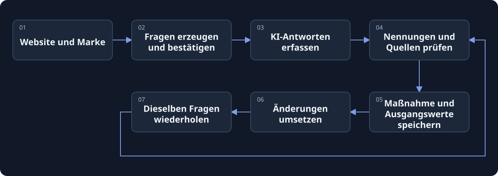

[](https://beatapi.io/geo)

# BeatGEO

[English](README.md) · [简体中文](README.zh-CN.md) · [日本語](README.ja.md) · [Deutsch](README.de.md) · [한국어](README.ko.md)

**Die Open-Source-Alternative zu Profound für GEO & AEO.**

Ein quelloffener GEO-/AEO-Arbeitsbereich von [BeatAPI](https://beatapi.io). Verfolge Markennennungen und Quellen in echten KI-Antworten, leite Verbesserungen ab und wiederhole dieselben Fragen, um Veränderungen zu vergleichen.

[Website](https://beatapi.io/geo) · [Schnellstart](#schnellstart) · [Ablauf](#ablauf) · [Funktionsstand](#funktionsstand) · [Roadmap](docs/roadmap.md) · [MIT-Lizenz](LICENSE.md)

[](assets/readme/beatgeo-demo.mp4)

Echte Bildschirme aus einem aufgezeichneten BeatAPI-Test vom 2026-10-22, als Rückblick und nicht als Live-Lauf. [Fallnotizen auf Chinesisch](docs/beat-geo/cases/beatapi-agent/README.md)

> **Lokales MVP / Quellcode-Vorschau.** Die Kette ChatGPT-Erfassung → Datenbank → Worker wurde in Live-Smoke-Tests geprüft. Andere Engines, kostenpflichtige Recherche und unbeaufsichtigter Dauerbetrieb haben eigene Prüfgrenzen. [Prüfprotokoll auf Englisch](docs/beat-geo/validation.md)

## Von der Website zu wiederholbaren Fragen

Gib deine Website und dein Geschäftsfeld an, bestätige die vorgeschlagenen Fragen und sammle Antworten in deinem angemeldeten Chrome-Profil. Prüfe die Belege, bevor du Änderungen planst.

- **Kein leeres Fragenformular.** Website-Recherche erzeugt Vorschläge; Branchenvorlagen funktionieren auch ohne Recherche-API-Key.
- **Originalbelege bleiben erhalten.** Antworten, sichtbare Quellenlinks und Erfassungsstatus sind nachvollziehbar. Ein Timeout zählt nicht als fehlende Sichtbarkeit.
- **Verbesserungen erneut messen.** Speichere eine Maßnahme mit Ausgangswerten, dokumentiere ihre Umsetzung und wiederhole dieselben Fragen.
- **Ein gemeinsames Produktsystem.** Marken, Fragen, Belege, Maßnahmen und Zeitplanung nutzen PostgreSQL und eine Warteschlange. BeatBrowser ist als fest versionierte Abhängigkeit enthalten.

## Schnellstart

Benötigt werden **Git, Node.js 24, pnpm 12.4.1 und Chrome**. BeatGEO bringt PostgreSQL mit und verwaltet es automatisch. Docker und eine separate Datenbankinstallation sind nicht erforderlich.

```sh
git clone https://github.com/BeatAPI/BeatGEO.git
cd BeatGEO
node scripts/local-doctor.mjs
pnpm local:setup
pnpm local:start
```

Öffne **http://localhost:3140/setup** und registriere den lokalen Administrator:

1. **Recherche verbinden.** BeatAPI-Key unter Connections prüfen, Recherchemodell auswählen und speichern. Alternativ diesen Schritt überspringen und Branchenvorlagen nutzen.
2. **Chrome verbinden.** Unter `chrome://extensions` den Entwicklermodus aktivieren und `.beat-geo/extension` entpackt laden. Verbundenes Profil auswählen und dort bei ChatGPT anmelden. Eine verbundene Erweiterung bestätigt keine Website-Anmeldung.
3. **Marke anlegen.** Website eingeben → Fragen erzeugen und bestätigen → erste Erfassung → Antworten und Quellen prüfen → Verbesserung speichern → dieselben Fragen erneut testen.

Das Setup richtet eine eigene lokale PostgreSQL-Datenbank und die Erweiterung ein. Kein zweiter Repository-Klon, kein zusätzliches BeatBrowser-Konto und keine globale CLI-Installation nötig. Eine vorhandene BeatBrowser-Verbindung kann verwendet werden; pro Chrome-Profil nur eine Erweiterungskopie aktivieren.

**Für laufendes Monitoring muss die Umgebung laufen:** Computer wach und online halten; Chrome und `pnpm local:start` müssen aktiv bleiben. Der Dashboard-Tab darf geschlossen werden. Zum Neustart reicht `pnpm local:start`; die Datenbank nicht neu anlegen. Bei ausgeschaltetem oder offline befindlichem Computer findet keine Erfassung statt.

[Ausführliche Einrichtung auf Chinesisch](docs/beat-geo/getting-started.md) · [Vorhandenes PostgreSQL einrichten, Chinesisch](docs/self-hosting.md)

## Ablauf



BeatGEO verwaltet Produktdaten und Zeitplanung. **BeatBrowser** führt Aufgaben im angemeldeten Browser aus. **BeatAPI** kann Suche, Seitenabruf und Modellanalyse für Recherche und Optimierung bereitstellen.

<details>
<summary>Den größeren Produktentwurf ansehen</summary>

[](docs/product/flow.html)

Den [interaktiven Entwurf](docs/product/flow.html) lokal öffnen. Er zeigt das **Zielbild** mit noch unfertigen Funktionen und synthetischen Beispielen, keine vollständig implementierte Oberfläche. [Funktionsübersicht](docs/product/features.csv)

</details>

## Funktionsstand

| Bereich | Aktueller Stand |
| --- | --- |
| ChatGPT-Webantworten | Live-Smoke-Tests über den Worker erfolgreich; Antworten und sichtbare Quellen werden gespeichert. Website-Änderungen erfordern Wartung. |
| Gemini-Webantworten | Adapter vorhanden; zuverlässiger Abschluss im Hintergrund noch nicht bestätigt. Fehler werden angezeigt. |
| Weitere Antwortsysteme | Keine Zusage vollständiger Browser-Unterstützung. Bitte die Roadmap prüfen. |
| Fragen und Verbesserungen | Fragen auf Englisch/Chinesisch, Branchenvorlagen, gespeicherte Ausgangswerte und vergleichbare Wiederholungstests. |
| Planung und Speicherung | PostgreSQL + pg-boss. Der nächste Lauf wurde im Live-Test eingereiht; unbeaufsichtigter Dauerbetrieb bleibt zu prüfen. Kein SQLite. |
| BeatAPI-Recherche | Suche, Seitenabruf und Modellintegration implementiert; Abnahme mit echtem Key und kostenpflichtigen Aufrufen ausstehend. |
| Website-Prüfung und Entwürfe | Begrenzte HTML-/robots-/Sitemap-Prüfung, kostenlose Gliederungen, Bearbeitung und Freigabe je Version. Grenzen der Netzwerk- und kostenpflichtigen KI-Tests stehen im Prüfbericht. |
| SEO-Daten | Nicht angeschlossen. Keine Keyword-Volumina, Backlink-Indizes oder echten KI-Fragevolumina. |

Die README gibt es auf Englisch, Chinesisch, Japanisch, Deutsch und Koreanisch. **Die Produktoberfläche lässt sich über EN / 中文 zwischen Englisch und Chinesisch umschalten. Die Auswahl wird im Browser gespeichert.** Fragen, Markennamen und gesammelte Antworten bleiben in ihrer ursprünglichen Sprache. Die README-Übersetzungen bedeuten keine fünfsprachige Oberfläche.

## Was die Kennzahlen bedeuten

**Nennungsrate = gültige Antworten mit Markennennung ÷ gültige, auswertbare Antworten.** Fehler, ausstehende Versuche, Timeouts und fehlende Anmeldungen zählen nicht zum Nenner. Gleiche observation IDs werden dedupliziert.

Bei 100 geplanten Versuchen, 80 gültigen Antworten und 24 Nennungen beträgt die Rate **30 % (24/80)**. Die Abschlussquote ist eine eigene Kennzahl. Der Arbeitsbereich wertet gespeicherte Beobachtungen aus; eine vollständige Abdeckung aller geplanten Versuche muss separat umgesetzt werden. Eine Nennung ist keine Empfehlung, eine Kontostichprobe keine marktweite Sichtbarkeit. [Kennzahlendefinitionen](docs/metrics.md)

## Wofür BeatAPI verwendet wird

Key und Recherchemodell unter **Connections** speichern. BeatAPI kann Geschäfts- und Wettbewerbsinformationen suchen, Seiten lesen, Fragen generieren und Belege analysieren. Keys werden verschlüsselt gespeichert und nicht an den Browser-Client zurückgegeben. Aktuell gelten sie für die lokale Instanz, nicht getrennt pro Mandant.

Browser-Erfassung, Branchenvorlagen und Grundstatistiken benötigen keine kostenpflichtigen Modellaufrufe. Recherche und Generierung verbrauchen das API-Guthaben des konfigurierten Anbieters; für Web-Erfassung gelten die Grenzen deines Website-Kontos. Spezielle SEO-Datenendpunkte sind noch nicht angeschlossen. [Integrationskonzept auf Chinesisch](docs/beat-geo/beatapi-product-loop.md)

## Forks und Teamnutzung

Ein Fork von BeatGEO enthält weiterhin die **fest versionierte BeatBrowser-Abhängigkeit**. Er erzeugt keinen zusätzlichen BeatBrowser-Fork. Das Setup lädt die festgelegte Revision und bereitet die Erweiterung vor. Nur wer BeatBrowser selbst ändern möchte, muss es separat forken und Abhängigkeit sowie Lockfile aktualisieren.

Lokale Installationen haben getrennte Konten, Datenbanken, Keys und Chrome-Sitzungen. `.env`, `.beat-geo/`, Browserbelege und Zugangsdaten nicht committen. Dienste nur auf Loopback betreiben und nicht über öffentliche Tunnel freigeben. [Datenschutz](docs/privacy.md)

## Entwicklung und Referenzen

```sh
pnpm install --frozen-lockfile
pnpm lint
pnpm test:browser
pnpm test
```

Lockfile und Lieferkettenschutz beibehalten; Änderungen über PRs einreichen. Nur das Browser-Lab testen: `pnpm browser:lab`, dann `http://127.0.0.1:4318`. Diese separate Ansicht besitzt kein Produktdatenbank- oder Kontosystem.

[Architektur auf Chinesisch](docs/beat-geo/architecture-and-ego.md) · [Kennzahlen](docs/metrics.md) · [Roadmap](docs/roadmap.md) · [Validierung](docs/beat-geo/validation.md)

## Lizenz und Danksagung

[MIT](LICENSE.md). BeatGEO basiert auf dem MIT-lizenzierten Elmo und erhält dessen Copyright und Historie. [BeatBrowser](https://github.com/BeatAPI/BeatBrowser) ist unter MIT enthalten; siehe [Drittanbieterhinweise](THIRD_PARTY_NOTICES.md). Andere untersuchte GEO-Projekte sind Referenzen, nicht automatisch vollständig integrierte Implementierungen. BeatGEO ist unabhängig von Profound.
