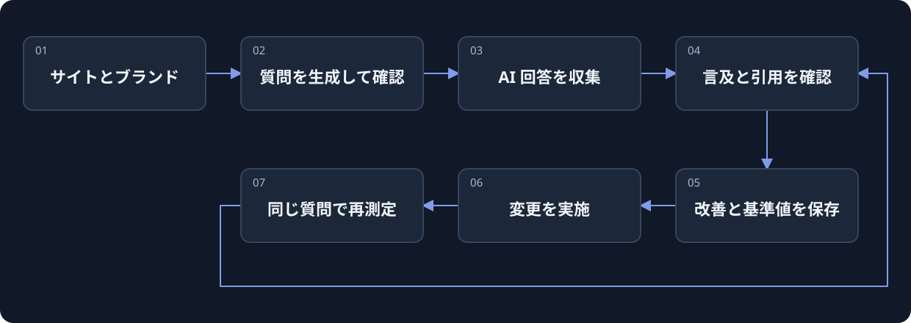

[](https://beatapi.io/geo)

# BeatGEO

[English](README.md) · [简体中文](README.zh-CN.md) · [日本語](README.ja.md) · [Deutsch](README.de.md) · [한국어](README.ko.md)

**GEO と AEO のための、オープンソースの Profound 代替ツール。**

[BeatAPI](https://beatapi.io) が開発するオープンソースの GEO / AEO ワークスペースです。実際の AI 回答からブランドへの言及と引用を追跡し、改善事項を記録。同じ質問で再測定して変化を比較します。

[公式サイト](https://beatapi.io/geo) · [クイックスタート](#クイックスタート) · [ワークフロー](#ワークフロー) · [対応状況](#対応状況) · [ロードマップ](docs/roadmap.md) · [MIT ライセンス](LICENSE.md)

[](assets/readme/beatgeo-demo.mp4)

2026-10-22 に記録した BeatAPI 実測の実画面をまとめた振り返りで、ライブ実行ではありません。[ケース記録（中国語）](docs/beat-geo/cases/beatapi-agent/README.md)

> **ローカル MVP / ソースプレビュー版。** ChatGPT の収集 → データベース → worker は実環境のスモークテストを通過しています。他のエンジン、有料リサーチ、長期間の無人運用は別途検証が必要です。[検証記録（英語）](docs/beat-geo/validation.md)

## Web サイトから、継続して測定できる質問へ

サイトと事業内容を入力し、提案された質問を確認します。ログイン済みの Chrome で回答を集め、根拠を見てから改善内容を決めます。

- **質問をゼロから書く必要はありません。** サイトのリサーチから質問案を生成。リサーチ用 API キーがなくても業種別テンプレートを利用できます。
- **回答と根拠を残します。** 元の回答、表示された引用リンク、収集状態を確認できます。タイムアウトは露出ゼロとして集計しません。
- **改善後も同じ条件で測定します。** アクションと基準値を保存し、実施内容を記録した後、同じ質問を再実行します。
- **製品データを一元管理します。** ブランド、質問、根拠、改善、スケジュールは PostgreSQL と単一のキューを使用。BeatBrowser はバージョン固定の依存関係として同梱されます。

## クイックスタート

**Git、Node.js 24、pnpm 12.4.1、Chrome** を用意してください。PostgreSQL は BeatGEO に同梱され、自動管理されます。Docker やデータベースの別途インストールは不要です。

```sh
git clone https://github.com/BeatAPI/BeatGEO.git
cd BeatGEO
node scripts/local-doctor.mjs
pnpm local:setup
pnpm local:start
```

**http://localhost:3140/setup** を開き、ローカル管理者を登録します。

1. **リサーチを設定。** Connections で BeatAPI キーを検証し、リサーチモデルを選択して保存します。スキップして業種別の初期質問を使うこともできます。
2. **Chrome を接続。** `chrome://extensions` でデベロッパーモードを有効にし、`.beat-geo/extension` を読み込みます。接続したプロファイルを選び、同じプロファイルで ChatGPT にログインしてください。拡張機能の接続とサイトへのログインは別です。
3. **ブランドを作成。** サイトを入力 → 質問を生成して確認 → 初回収集 → 回答と引用を確認 → 改善を記録 → 同じ質問で再測定します。

セットアップが専用のローカル PostgreSQL と拡張機能を準備します。BeatBrowser を別にクローンしたり、別アカウントやグローバル CLI を用意したりする必要はありません。既存の接続も利用できますが、同じ Chrome プロファイルで拡張機能を二重に有効化しないでください。

**継続監視には稼働中の環境が必要です。** パソコンをスリープさせず、ネット接続、Chrome、`pnpm local:start` を維持します。ダッシュボードのタブは閉じても構いません。再開時は `pnpm local:start` を実行し、データベースは作り直さないでください。オフライン中の収集はできません。

[詳しい導入手順（中国語）](docs/beat-geo/getting-started.md) · [既存 PostgreSQL の設定（中国語）](docs/self-hosting.md)

## ワークフロー



BeatGEO が製品データとスケジュールを管理し、**BeatBrowser** がログイン済みブラウザで処理を実行します。**BeatAPI** はリサーチ向けの検索、ページ読み取り、モデル分析を提供できます。

<details>
<summary>製品全体の構想を見る</summary>

[](docs/product/flow.html)

[対話型の構想図](docs/product/flow.html)はローカルで開けます。**目標とする製品像**であり、未完成の機能や合成例を含みます。実装済み画面ではありません。[機能一覧](docs/product/features.csv)

</details>

## 対応状況

| 項目 | 現在の状態 |
| --- | --- |
| ChatGPT の Web 回答 | worker を通す実環境テストに成功。回答と表示された引用を保存します。サイト変更への継続対応は必要です。 |
| Gemini の Web 回答 | アダプターは存在しますが、バックグラウンドでの回答完了の安定性は未検証です。失敗は表示されます。 |
| その他の回答エンジン | Web 収集の全面対応は保証していません。ロードマップを確認してください。 |
| 質問と改善 | 英語・中国語の質問生成、業種別テンプレート、改善の基準値保存、同一質問での再測定。 |
| スケジュールと保存 | PostgreSQL + pg-boss。実測では次回処理の予約まで確認。長期間の無人運用と SQLite には未対応です。 |
| BeatAPI リサーチ | 検索・読み取り・モデル連携は実装済み。実キーによる有料呼び出しの受け入れ検証は未完了です。 |
| サイト確認・コンテンツ下書き | 範囲を限定した HTML/robots/sitemap 確認、無料アウトライン、編集と版ごとの承認。公開ネットワークと有料生成の検証範囲はレポートを参照。 |
| SEO データ | 未接続。検索量、被リンク索引、実際の AI 質問量は提供しません。 |

README は英語、中国語、日本語、ドイツ語、韓国語で提供します。**製品 UI は EN / 中文で英語と中国語を切り替えられ、選択はブラウザーに保存されます。** 質問、ブランド名、収集した回答の言語は変更しません。README の翻訳は UI の五言語対応を意味しません。

## 指標の読み方

**言及率 = ブランドに言及した有効回答数 ÷ 評価可能な有効回答数。** 失敗、待機、タイムアウト、未ログインは分母から除外し、同じ observation ID は重複集計しません。

100 回を予定し、80 回の有効回答中 24 回に言及があれば **30%（24/80）** です。完了率は別の指標です。現在のワークベンチは保存済み観測を集計し、予定した全試行の網羅率は別途実装が必要です。言及は必ずしも推薦ではなく、単一アカウントのサンプルは市場全体の露出ではありません。[指標定義](docs/metrics.md)

## BeatAPI の使いどころ

**Connections** でキーとリサーチモデルを設定します。事業・競合情報の検索、ページ読み取り、質問生成、収集した根拠の分析に利用できます。キーは暗号化して保存され、ブラウザ側に返されません。現在はローカルインスタンスで共有する認証情報であり、テナント別管理ではありません。

ブラウザ収集、業種テンプレート、基本集計には有料モデル呼び出しは不要です。リサーチと生成は設定した API の残高を消費し、Web 収集にはサイトアカウント側の制限が適用されます。SEO 専用データ API はまだ接続されていません。[連携設計（中国語）](docs/beat-geo/beatapi-product-loop.md)

## Fork とチーム利用

BeatGEO を fork すると **BeatBrowser の固定バージョン依存関係**が残ります。BeatBrowser の別 fork が自動生成されるわけではありません。セットアップ時に指定版を取得して拡張機能を準備します。BeatBrowser 自体を変更する場合だけ別途 fork し、依存関係とロックファイルを更新してください。

各ローカル環境のアカウント、DB、キー、Chrome セッションは独立しています。`.env`、`.beat-geo/`、ブラウザ証拠データや認証情報をコミットしないでください。サービスは loopback に限定し、公開トンネルに接続しないでください。[プライバシー](docs/privacy.md)

## 開発と参考資料

```sh
pnpm install --frozen-lockfile
pnpm lint
pnpm test:browser
pnpm test
```

ロックファイルとサプライチェーン保護を維持し、変更は PR で提出します。ブラウザラボだけを試す場合は `pnpm browser:lab` → `http://127.0.0.1:4318`。この単独画面には製品の DB・アカウント機能はありません。

[アーキテクチャ（中国語）](docs/beat-geo/architecture-and-ego.md) · [指標](docs/metrics.md) · [ロードマップ](docs/roadmap.md) · [検証](docs/beat-geo/validation.md)

## ライセンスと謝辞

[MIT](LICENSE.md)。BeatGEO は MIT ライセンスの Elmo を基にし、元の著作権と履歴を保持しています。[BeatBrowser](https://github.com/BeatAPI/BeatBrowser) も MIT で同梱されます。[第三者の権利表示](THIRD_PARTY_NOTICES.md)。調査した他の GEO プロジェクトは参考資料であり、その全実装を含むとは限りません。BeatGEO は Profound とは独立したプロジェクトです。
