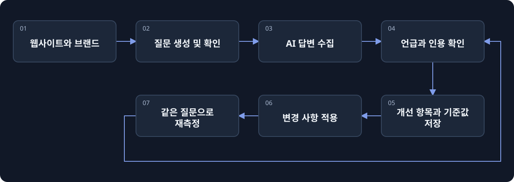

[](https://beatapi.io/geo)

# BeatGEO

[English](README.md) · [简体中文](README.zh-CN.md) · [日本語](README.ja.md) · [Deutsch](README.de.md) · [한국어](README.ko.md)

**GEO와 AEO를 위한 오픈 소스 Profound 대안.**

[BeatAPI](https://beatapi.io)가 만드는 오픈 소스 GEO / AEO 워크스페이스입니다. 실제 AI 답변에서 브랜드 언급과 인용을 추적하고, 개선 사항을 실행한 뒤 같은 질문으로 다시 측정해 변화를 비교합니다.

[공식 웹사이트](https://beatapi.io/geo) · [빠른 시작](#빠른-시작) · [제품 흐름](#제품-흐름) · [지원 현황](#지원-현황) · [로드맵](docs/roadmap.md) · [MIT 라이선스](LICENSE.md)

[](assets/readme/beatgeo-demo.mp4)

2026-10-22에 기록한 BeatAPI 실측의 실제 화면을 정리한 회고이며, 실시간 실행이 아닙니다. [사례 기록 — 중국어](docs/beat-geo/cases/beatapi-agent/README.md)

> **로컬 MVP / 소스 미리보기 버전.** ChatGPT 수집 → 데이터베이스 → worker 경로는 실제 스모크 테스트를 통과했습니다. 다른 엔진, 유료 리서치, 장기 무인 운영은 별도로 검증해야 합니다. [검증 기록 — 영어](docs/beat-geo/validation.md)

## 웹사이트 하나에서 반복 가능한 질문 세트로

웹사이트와 사업 정보를 입력하고 제안된 질문을 확인하세요. 로그인된 Chrome에서 답변을 수집한 뒤, 근거를 보고 무엇을 개선할지 결정합니다.

- **질문을 처음부터 쓰지 않아도 됩니다.** 웹사이트 리서치로 질문 초안을 만들거나, 리서치 API 키 없이 업종별 템플릿을 사용할 수 있습니다.
- **원본 근거를 남깁니다.** 답변, 화면에 표시된 출처 링크, 수집 상태를 확인합니다. 시간 초과를 노출 0으로 계산하지 않습니다.
- **개선 결과를 다시 측정합니다.** 실행 항목과 기준값을 저장하고 변경 내용을 기록한 후 같은 질문을 재실행합니다.
- **하나의 제품 시스템을 사용합니다.** 브랜드, 질문, 근거, 개선 항목과 일정은 PostgreSQL 및 단일 큐를 공유합니다. BeatBrowser는 버전이 고정된 의존성으로 포함됩니다.

## 빠른 시작

**Git, Node.js 24, pnpm 12.4.1, Chrome**을 준비하세요. PostgreSQL은 BeatGEO에 포함되어 자동으로 관리됩니다. Docker나 별도의 데이터베이스를 설치할 필요가 없습니다.

```sh
git clone https://github.com/BeatAPI/BeatGEO.git
cd BeatGEO
node scripts/local-doctor.mjs
pnpm local:setup
pnpm local:start
```

**http://localhost:3140/**을 열면 로컬 작업 공간으로 바로 들어갑니다. BeatGEO 회원가입, 로그인, 비밀번호 설정은 필요하지 않습니다. `/setup`에서 BeatAPI와 Chrome을 연결할 수 있습니다.

1. **브랜드 생성.** 웹사이트 입력 → 질문 생성 및 확인 → 첫 수집 → 답변과 인용 확인 → 개선 항목 저장 → 같은 질문으로 재측정합니다.
2. **Chrome 연결.** `chrome://extensions`에서 개발자 모드를 켜고 `.beat-geo/extension`을 압축 해제된 확장 프로그램으로 로드합니다. 연결된 프로필을 선택하고 같은 프로필에서 ChatGPT에 로그인하세요. 확장 프로그램 연결과 웹사이트 로그인은 별개입니다.
3. **리서치 연결.** Connections에서 BeatAPI 키를 검증하고 리서치 모델을 선택해 저장합니다. 건너뛰고 업종별 기본 질문을 사용해도 됩니다.

설치 과정에서 전용 로컬 PostgreSQL과 확장 프로그램을 준비합니다. 별도의 저장소 복제, BeatBrowser 계정, 전역 CLI 설치는 필요하지 않습니다. 기존 BeatBrowser 연결을 재사용할 수 있지만, Chrome 프로필 하나에는 확장 프로그램 한 개만 활성화하세요.

**지속적인 모니터링에는 실행 중인 환경이 필요합니다.** 컴퓨터가 절전 모드에 들어가지 않도록 하고 인터넷 연결, Chrome, `pnpm local:start`를 유지하세요. 대시보드 탭은 닫아도 됩니다. 다음에는 `pnpm local:start`로 다시 시작하며, 데이터베이스를 새로 만들지 않습니다. 컴퓨터가 오프라인이면 수집도 중단됩니다.

[상세 설치 안내 — 중국어](docs/beat-geo/getting-started.md) · [기존 PostgreSQL 설정 — 중국어](docs/self-hosting.md)

## 제품 흐름



BeatGEO는 제품 데이터와 일정을 관리합니다. **BeatBrowser**는 로그인된 브라우저에서 작업을 실행합니다. **BeatAPI**는 리서치와 개선을 위한 검색, 페이지 읽기, 모델 분석을 제공할 수 있습니다.

<details>
<summary>전체 제품 구상 보기</summary>

[](docs/product/flow.html)

[인터랙티브 설계도](docs/product/flow.html)는 로컬에서 열 수 있습니다. 미완성 기능과 합성 예시를 포함한 **목표 제품 구상**이며, 모든 기능이 구현된 화면은 아닙니다. [기능 목록](docs/product/features.csv)

</details>

## 지원 현황

| 영역 | 현재 상태 |
| --- | --- |
| ChatGPT 웹 답변 수집 | 실제 worker 경로 테스트 통과. 답변과 표시된 인용을 저장합니다. 웹사이트 변경에 따른 유지보수는 필요합니다. |
| Gemini 웹 답변 수집 | 어댑터는 있지만 백그라운드 답변 완료의 안정성은 아직 검증되지 않았습니다. 실패 상태는 표시됩니다. |
| 다른 답변 엔진 | 모든 엔진의 브라우저 수집을 지원한다고 보장하지 않습니다. 로드맵을 확인하세요. |
| 질문 및 개선 | 영어·중국어 질문 생성, 업종별 템플릿, 개선 기준값 저장, 같은 질문으로 재측정. |
| 일정 및 저장 | PostgreSQL + pg-boss. 실제 검증에서 다음 작업이 예약됨을 확인했으며 장기 무인 운영은 미검증입니다. SQLite는 지원하지 않습니다. |
| BeatAPI 리서치 | 검색·읽기·모델 연동 구현. 실제 키를 사용한 유료 호출 검증은 아직 완료되지 않았습니다. |
| 사이트 확인 및 콘텐츠 초안 | 제한된 HTML/robots/sitemap 확인, 무료 개요, 편집과 버전별 승인. 공개 네트워크 및 유료 AI 검증 범위는 보고서를 참고하세요. |
| SEO 데이터 | 미연동입니다. 키워드 검색량, 백링크 색인, 실제 AI 질문량을 제공하지 않습니다. |

README는 영어, 중국어, 일본어, 독일어, 한국어로 제공합니다. **제품 UI는 EN / 中文으로 영어와 중국어를 전환할 수 있으며 선택은 브라우저에 저장됩니다.** 질문, 브랜드명, 수집한 답변은 원래 언어를 유지합니다. README 번역이 UI의 5개 언어 지원을 뜻하지는 않습니다.

## 지표 해석

**언급률 = 브랜드를 언급한 유효 답변 수 ÷ 평가 가능한 유효 답변 수.** 실패, 대기, 시간 초과, 미로그인 시도는 분모에서 제외하고 동일한 observation ID는 중복 집계하지 않습니다.

100회를 계획했더라도 유효 답변 80개 중 24개가 브랜드를 언급했다면 **30% (24/80)**입니다. 완료율은 별도 지표입니다. 현재 워크벤치는 저장된 관측을 집계하며, 계획된 전체 시도의 커버리지는 별도로 구현해야 합니다. 언급은 반드시 추천을 의미하지 않으며, 한 계정의 표본은 전체 시장 노출이 아닙니다. [지표 정의](docs/metrics.md)

## BeatAPI 활용

**Connections**에서 키와 리서치 모델을 설정합니다. 사업·경쟁사 정보 검색, 페이지 읽기, 질문 생성, 수집 근거 분석에 사용할 수 있습니다. 키는 암호화해 저장하고 브라우저 클라이언트에 반환하지 않습니다. 현재는 테넌트별 키가 아닌 로컬 인스턴스 공용 자격 증명입니다.

브라우저 수집, 업종 템플릿, 기본 통계에는 유료 모델 호출이 필요하지 않습니다. 리서치와 생성은 설정한 제공자의 API 잔액을 사용하며, 웹 수집에는 웹사이트 계정의 제한이 적용됩니다. SEO 전용 데이터 API는 아직 연결되지 않았습니다. [연동 설계 — 중국어](docs/beat-geo/beatapi-product-loop.md)

## Fork 및 팀 사용

BeatGEO를 fork하면 **버전이 고정된 BeatBrowser 의존성**이 유지됩니다. BeatBrowser 저장소까지 별도로 fork되는 것은 아닙니다. 설치 시 지정된 버전을 다운로드해 확장 프로그램을 준비합니다. BeatBrowser 자체를 수정할 개발자만 별도로 fork하고 의존성과 잠금 파일을 업데이트하면 됩니다.

각 로컬 설치의 계정, 데이터베이스, 키, Chrome 세션은 독립적입니다. `.env`, `.beat-geo/`, 브라우저 근거 데이터와 자격 증명을 커밋하지 마세요. 서비스는 loopback에만 바인딩하고 공개 터널에 노출하지 마세요. [개인정보 안내](docs/privacy.md)

## 개발 및 참고

```sh
pnpm install --frozen-lockfile
pnpm lint
pnpm test:browser
pnpm test
```

잠금 파일과 공급망 보호 설정을 유지하고 PR로 변경을 제출합니다. 브라우저 랩만 보려면 `pnpm browser:lab`을 실행한 뒤 `http://127.0.0.1:4318`을 엽니다. 이 독립 화면에는 제품 데이터베이스나 계정 시스템이 없습니다.

[아키텍처 — 중국어](docs/beat-geo/architecture-and-ego.md) · [지표](docs/metrics.md) · [로드맵](docs/roadmap.md) · [검증](docs/beat-geo/validation.md)

## 라이선스 및 감사

[MIT](LICENSE.md). BeatGEO는 MIT 라이선스의 Elmo를 기반으로 하며 원 저작권과 이력을 보존합니다. [BeatBrowser](https://github.com/BeatAPI/BeatBrowser)도 MIT로 포함됩니다. [서드파티 고지](THIRD_PARTY_NOTICES.md)를 참고하세요. 조사한 다른 GEO 프로젝트는 참고 자료이며 모든 구현을 포함한다는 뜻은 아닙니다. BeatGEO는 Profound와 독립적인 프로젝트입니다.
