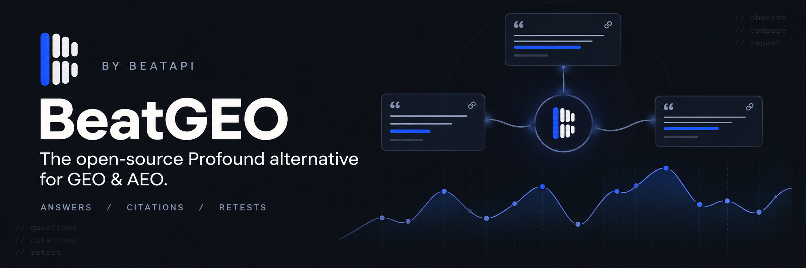
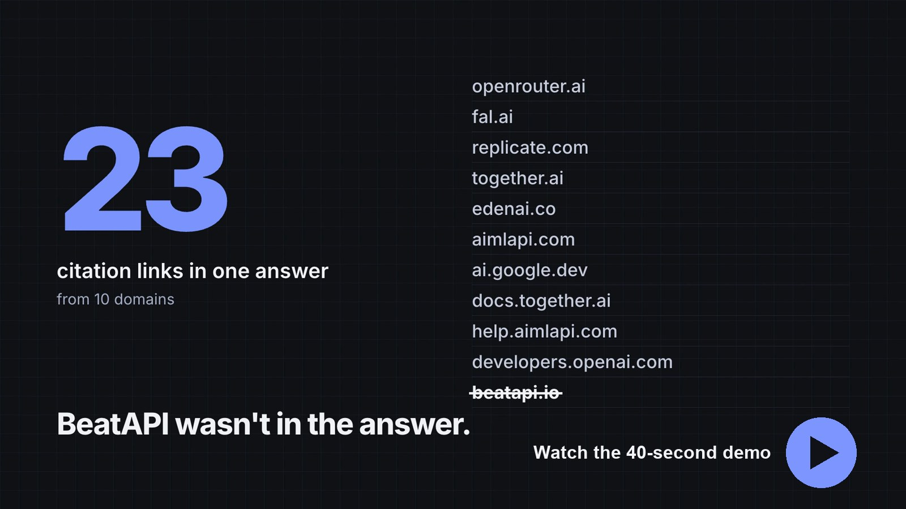
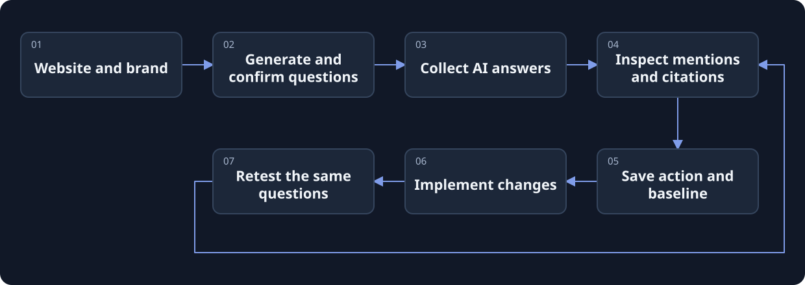
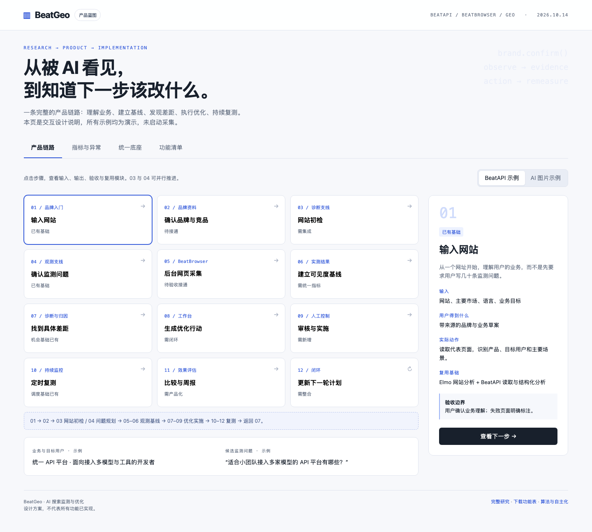

[](https://beatapi.io/geo)

# BeatGEO

[English](README.md) · [简体中文](README.zh-CN.md) · [日本語](README.ja.md) · [Deutsch](README.de.md) · [한국어](README.ko.md)

**The open-source Profound alternative for GEO & AEO.**

An open-source GEO / AEO workspace by [BeatAPI](https://beatapi.io). Track brand mentions and citations in real AI answers, turn gaps into actions, and rerun the same questions to compare results.

[Website](https://beatapi.io/geo) · [Quick start](#quick-start) · [Product workflow](#the-product-workflow) · [Current support](#current-support) · [Roadmap](docs/roadmap.md) · [MIT license](LICENSE.md)

[](assets/readme/beatgeo-demo.mp4)

Real screens from a recorded BeatAPI test on 2026-10-22, replayed as a summary rather than a live run. [Case notes](docs/beat-geo/cases/beatapi-agent/README.md)

> **Local MVP / source preview.** The ChatGPT collection → database → worker path has passed live smoke tests. Other engines, paid research and unattended operation have separate acceptance boundaries. [Validation log](docs/beat-geo/validation.md)

## From a website to a repeatable question set

Start with your website and business. Review suggested monitoring questions, collect answers in your signed-in Chrome, and inspect the evidence before deciding what to change.

- **Start with questions, not a blank editor.** Website research generates a draft question set; industry templates work without a research API key.
- **Keep the original evidence.** Inspect answers, visible source links and collection status. A timeout is shown as a timeout, not zero exposure.
- **Make changes measurable.** Save an optimization action and its baseline, record what you implemented, then retest the same questions.
- **Use one local workspace.** Brands, questions, evidence, actions and scheduling share PostgreSQL and one queue. BeatBrowser is included as a pinned dependency.

## Quick start

Prepare **Git, Node.js 24, pnpm 12.4.1, and Chrome**. PostgreSQL is bundled and managed by BeatGEO; no Docker or separate database installation is required.

```sh
git clone https://github.com/BeatAPI/BeatGEO.git
cd BeatGEO
node scripts/local-doctor.mjs
pnpm local:setup
pnpm local:start
```

Open **http://localhost:3140/** to enter your local workspace directly. There is no BeatGEO registration, login or password. Connections at `/setup` lets you add an optional BeatAPI key and connect Chrome:

1. **Create a brand.** Enter the website, generate and confirm questions, then start the first collection. Read the answers and citations, save an improvement, and compare a retest.
2. **Connect Chrome.** Load `.beat-geo/extension` via `chrome://extensions` → Developer mode → Load unpacked. Select the connected profile and sign in to ChatGPT in that profile. An extension connection does not establish website login.
3. **Connect research.** In Connections, enter a BeatAPI key, validate it, select a research model and save. You can skip research and use industry starter questions.

The installer prepares a dedicated local PostgreSQL database and the included extension. No second repository clone, BeatBrowser account or global CLI installation is needed. Existing BeatBrowser connections can be reused; enable only one extension copy per profile.

**To keep monitoring:** leave the computer awake and online, with Chrome and `pnpm local:start` running. You can close the dashboard tab. Restart with `pnpm local:start`; do not recreate the database. This local edition does not provide monitoring while your computer is offline.

[Detailed onboarding — Chinese](docs/beat-geo/getting-started.md) · [Manual PostgreSQL setup — Chinese](docs/self-hosting.md)

## Work from your Agent

Give your MCP-capable Agent a website. The local MCP can create a paused brand, save reviewed questions, queue bounded BeatBrowser collection, inspect evidence, edit shared content drafts and control monitoring. The manual dashboard shows the same project and operation history. [Agent workflow and connection guide](docs/beat-geo/agent-workflow.md).

## The product workflow



BeatGEO owns the product records and schedule. **BeatBrowser** handles the signed-in browser task. **BeatAPI** can supply search, page reading and model analysis for research and optimization.

<details>
<summary>Explore the wider product blueprint</summary>

[](docs/product/flow.html)

Open [the interactive blueprint](docs/product/flow.html) locally to explore its steps. This is the **target product**, including unfinished features and synthetic examples. It is not a screenshot of completed functionality. [Feature inventory](docs/product/features.csv)

</details>

## Current support

| Area | Status |
| --- | --- |
| ChatGPT website collection | Live smoke tests passed through the worker, with answers and visible citations saved. Website changes still require maintenance. |
| Gemini website collection | Adapter present; background completion reliability remains unverified. Failures stay visible. |
| Other answer engines | Full browser collection parity is not claimed. Check the roadmap before relying on an engine. |
| Questions and optimization | English/Chinese question generation, industry templates, saved action baselines and comparable retests. |
| Scheduling and storage | PostgreSQL + pg-boss. The next cycle was queued in live validation; long unattended operation has not been established. SQLite is not supported. |
| BeatAPI research | Search/read/model integration is implemented; acceptance with a real key and billed calls remains pending. |
| Website checks and drafts | Bounded HTML/robots/sitemap checks, free outlines, editable drafts and revision approval. Public-network and paid AI acceptance have stated limits. |
| SEO datasets | Not connected. No claimed keyword volumes, backlink index or real AI prompt-volume dataset. |

README translations: English, Chinese, Japanese, German and Korean. **Switch the dashboard between English and Chinese using EN / 中文. Your preference is saved in this browser.** Questions, brand names and collected answers retain their original language. The translated READMEs do not imply five-language UI support.

## What the numbers mean

**Mention rate = valid answers mentioning the brand ÷ valid, scorable answers.** Failed, pending, timed-out or signed-out attempts do not enter that denominator. Repeated observation IDs are deduplicated.

For example, 24 mentions in 80 valid answers means **30% (24/80)**, even if 100 attempts were planned. Completion coverage is separate. The workbench currently summarizes saved observations, not a complete planned-attempt coverage ledger. A mention is not necessarily a recommendation; this account's sample is not market-wide exposure. [Metric definitions](docs/metrics.md)

## Where BeatAPI fits

Configure the research key and model in **Connections**. BeatAPI can search for business and competitor information, read pages, generate questions and analyze collected evidence. Saved keys are encrypted and are not returned to the browser client; credentials currently apply to the local instance rather than individual tenants.

Browser collection, starter templates and basic statistics do not require paid model calls. Research and generation use the configured provider's API balance; website collection uses your website account and its limits. Dedicated SEO data endpoints are not connected yet. [API integration design — Chinese](docs/beat-geo/beatapi-product-loop.md)

## Forking and team use

Forking BeatGEO keeps the **pinned BeatBrowser dependency**; it does not create a separate fork of BeatBrowser. Setup downloads that revision and prepares the extension. Developers changing BeatBrowser itself should fork it separately and explicitly update the dependency and lockfile.

Each local installation has its own private workspace, database, keys and Chrome sessions. Do not commit `.env`, `.beat-geo/`, browser evidence or credentials. Local services bind to loopback; do not expose them through a public tunnel. [Privacy](docs/privacy.md)

## Development and references

```sh
pnpm install --frozen-lockfile
pnpm lint
pnpm test:browser
pnpm test
```

Keep the lockfile and supply-chain protections. Submit changes through PRs. To inspect only the browser lab, run `pnpm browser:lab` and open `http://127.0.0.1:4318`; that standalone view has no product database/account system.

[Architecture — Chinese](docs/beat-geo/architecture-and-ego.md) · [Metrics](docs/metrics.md) · [Roadmap](docs/roadmap.md) · [Validation](docs/beat-geo/validation.md)

## License and acknowledgements

[MIT](LICENSE.md). BeatGEO builds on the MIT-licensed Elmo codebase and preserves its copyright and history. [BeatBrowser](https://github.com/BeatAPI/BeatBrowser) is included under MIT; see [third-party notices](THIRD_PARTY_NOTICES.md). Other researched GEO projects are references, not a claim that their full implementations are included. BeatGEO is independent of Profound.
