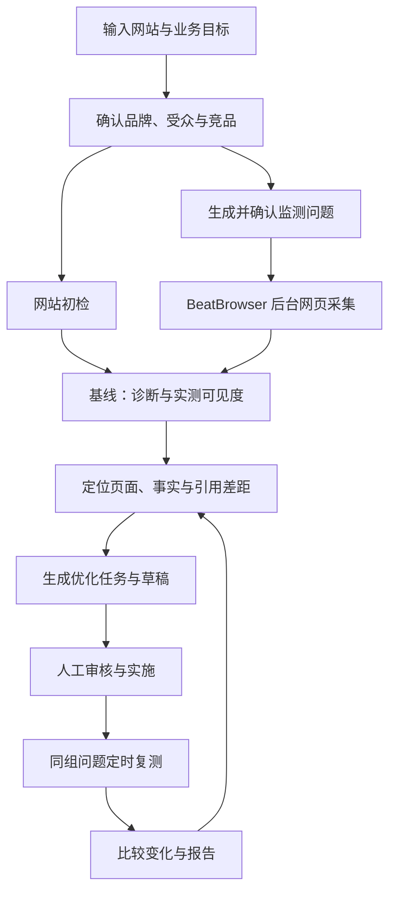

# BeatGeo

**Open-source AI visibility monitoring and optimization, by [BeatAPI](https://beatapi.io).**

从真实 AI 回答出发，了解品牌在哪里被提及、哪些页面被引用、哪里需要改进。使用 [BeatBrowser](https://github.com/BeatAPI/beat-browser) 在独立后台工作区采集网页回答，保留证据，明确显示超时与失败。

> **MVP / 开发预览。** 本地浏览器工作台、统一数据库/队列、优化任务与同组复测可运行，已完成一次 PostgreSQL→worker→真实 ChatGPT 验收。网站技术诊断、长期无人值守稳定性和多设备调度仍待完成。没有托管 SaaS、已发布 SDK 或全部平台已稳定支持的承诺。

## Product flow

这是目标产品链路，**不是所有步骤都已实现**。详见 [路线图](docs/roadmap.md) 和 [67 项功能表](docs/product/features.csv)。



[](docs/product/flow.html)

下载仓库后，用浏览器打开 [交互蓝图](docs/product/flow.html)，可点击步骤、切换 BeatAPI / AI 图片业务、查看指标和搜索功能。图中数字为合成示例。

## Quick start

需要 **Node.js 24、pnpm 12.4.1、Docker 和 Chrome**。BeatBrowser 固定版本已作为依赖带入，无需另外克隆或安装全局 CLI。

```sh
git clone https://github.com/BeatAPI/BeatGeo.git
cd BeatGeo
pnpm local:setup
pnpm local:start
```

打开 **http://localhost:3140/setup**，注册本地管理员，然后按页面完成：

1. **连接 Chrome**：已有 BeatBrowser 会直接复用；没有时，在 `chrome://extensions` 开启开发者模式，加载 `.beat-geo/extension` 文件夹。浏览器会要求你确认安装，网页不能静默安装扩展。选择已连接配置，并在该配置登录需要采集的网站。
2. **连接 BeatAPI（可选）**：输入 key → 验证并读取模型 → 选择研究模型 → 保存。key 加密存入同一个 PostgreSQL，页面只回显前四位；不填也可以选择行业生成题库，无需自己写问题。
3. **创建品牌**：填写网站 → 研究业务并从通用题库生成问题 → 确认问题 → 开始采集 → 查看原回答与引用 → 记录优化 → 复测比较。

`local:setup` 创建专用 PostgreSQL 容器和卷（loopback 55440）、独立随机密钥及两个忽略提交的环境文件。不会复用网站数据库；已有配置会拒绝覆盖。自动安装中断后可运行 `pnpm local:setup --resume`，它只接受未改动的自动配置。`local:start` 同时运行网页（3140）、采集服务（4319）和 worker；关闭终端即停止调度。已被其他 Agent 使用的 BeatBrowser bridge 不会随 BeatGeo 退出。

Chrome 连接成功不等于每个网站已登录。任务在独立 TaskSpace 中执行，无法创建时明确报错，不回退到日常标签页。首次采集也会显示超时、需要登录和连接失败，失败不计作零曝光。网站账号自身限制仍然适用。

高级配置与已有 PostgreSQL 安装见 [自托管指南](docs/self-hosting.md)。**SQLite 尚未实现**：当前查询和 pg-boss 依赖 PostgreSQL。始终保持一套产品账户、数据库与队列，本地 JSON 只是采集证据缓存。

单独体验浏览器工作台（没有数据库/账户功能）：

```sh
pnpm install --frozen-lockfile
pnpm browser:lab
# http://127.0.0.1:4318
```

## Questions without a blank page

默认由网站研究识别品类、受众和主要用途，再套用 12 类通用意图生成具体问题。通常包含 9 个不带品牌名的发现问题、3 个品牌认知/替代品问题；分别标记用途，避免把点名提问当成自然发现。支持中英文，行业不限于 AI 产品。

没有研究 API key 时，可从 8 个行业预设中选择，也可补充业务品类、受众和用途，生成行业初始题库。页面会明确区分“网站研究”与“行业模板”；两者都不是平台真实用户搜索量。问题可以修改或关闭，确认后存入现有品牌问题库，按固定问题长期复测，不在每轮监测时重新生成。

## MVP status

| 能力 | 本版状态 |
|---|---|
| 自己的品牌与问题 | 可用；按品牌筛选，多个品牌不混算提及率 |
| 独立后台工作区 | BeatBrowser TaskSpace，复用网站登录，无 Ego 依赖 |
| ChatGPT 网页采集 | 完整 worker 链路真实验收通过，答案/引用入库并安排下一周期；页面变化仍需持续验收 |
| Gemini 网页采集 | 适配器存在，后台长回答稳定性待验证；失败明确呈现 |
| 原回答、来源、导出 | 可用；只读取可见链接，尚未完整展开来源侧栏 |
| 超时与失败 | 单独显示原因、耗时、尝试次数，不当成零曝光 |
| 样本提及率 | 可用；有效分母、版本标识和观察 ID 去重 |
| 竞品声量 | 底座及纯函数可复用，浏览器工作台展示待接通 |
| 账户、品牌、问题、调度 | 一套 PostgreSQL + pg-boss；每次尝试独立记录，成功数据原子提交 |
| 优化行动与复测 | 保存机会和基线 → 记录实施 → 同队列复测 → 匹配比较及缺失数 |
| 首次使用与连接 | 网页配置 key / 模型，检测及选择 Chrome；自动安装携带固定版本扩展 |
| BeatAPI 研究 | Web Search / Read + 模型分析代码已接入；真实 key 的付费调用待验收 |
| 网站技术审计、推荐识别、SEO 数据 | 待开发/接入；关键词量、外链、排名不冒充已有数据 |

模拟测试不等于真实平台验收。[验收记录](docs/beat-geo/validation.md)

## Measurement

提及率 = **提及品牌的有效回答 / 可评分的有效回答**。超时、未登录、失败和等待不进入分母；相同 observation ID 去重。普通提及不等于推荐，当前账户的样本不等于全市场真实曝光。

例如计划 100 次，80 次有效，其中 24 次提及：提及率 **30%（24/80）**，计划覆盖率另报 **80%（80/100）**。当前工作台统计的是已保存观察的完成覆盖；完整计划覆盖率仍需独立实现。[指标定义](docs/metrics.md)

## One product system

```text
BeatGeo UI / API / MCP
  └─ 品牌、问题、证据、行动与报告 / PostgreSQL
      └─ pg-boss 统一业务队列
          ├─ BeatBrowser：网页观测与引用
          └─ 研究与模型能力：分析、内容和报告
```

当前 bridge 需同机 loopback 和共享 runner token。跨设备租约、离线补跑仍待接通；电脑离线不能声称持续采集。BeatAPI 能力账户与余额由现有网关负责，此仓库不另建钱包。

## BeatAPI integration

研究提供方可选择 BeatAPI：用 Web Search 发现业务与竞品资料，读取页面后生成建议，用文本模型分析已采集的证据。在 **Connections** 填写 key 和可用研究模型，也兼容服务器端 `BEATAPI_API_KEY` / `BEATAPI_RESEARCH_MODEL`。已保存的 key 不回传前端。浏览器采集与基础统计不要求购买模型 API。SEO 专用数据接口尚未接入。

[产品闭环、API 接入位置与商业化设计](docs/beat-geo/beatapi-product-loop.md)。当前为实例管理员统一凭据，不是每租户独立 BYOK 或完整成本账单。

## Privacy and independence

- 没有上游默认遥测项目、广告账号或客服项目；分析服务仅由操作者显式配置启用。
- 产品使用 BeatGeo 品牌，无上游购买入口、客户评价或评分背书。原营销站入口停用，历史商业文案不属于本项目承诺。
- cookies 不导出。证据默认位于 gitignored `.beat-geo/runs/`；没有新目录时可兼容读取已有 `.open-profound/runs/`，不自动搬迁或删除。
- 本地服务只绑定 loopback，校验 Host/Origin 和提交令牌；不要通过公网隧道暴露。
- 密钥兼容旧配置，改名不重置数据库或加密密钥。[隐私与迁移](docs/privacy.md)

## Development

```sh
pnpm install --frozen-lockfile
pnpm lint
pnpm test:browser
pnpm test
```

保留锁文件与供应链保护，不启用归档的上游部署或发布工作流。通过本仓库 PR 维护。

## License and acknowledgements

MIT。见 [LICENSE.md](LICENSE.md)、[第三方声明](THIRD_PARTY_NOTICES.md)。

基于 Elmo 的开源产品基础修改，保留原作者版权和历史。GeoScore、oneglanse、niubigeo、Ansvisor 等为研究及模块评估参考，不代表本版已经复制其全部代码。BeatGeo 与 Profound 无隶属关系。
