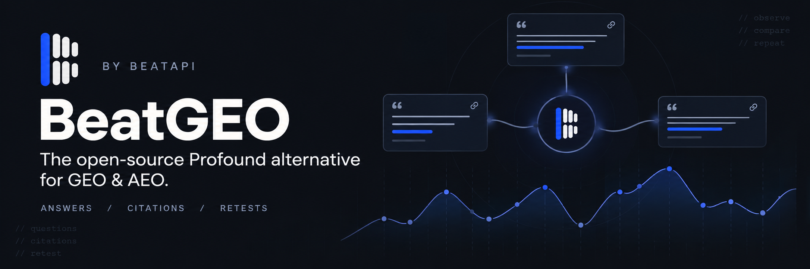
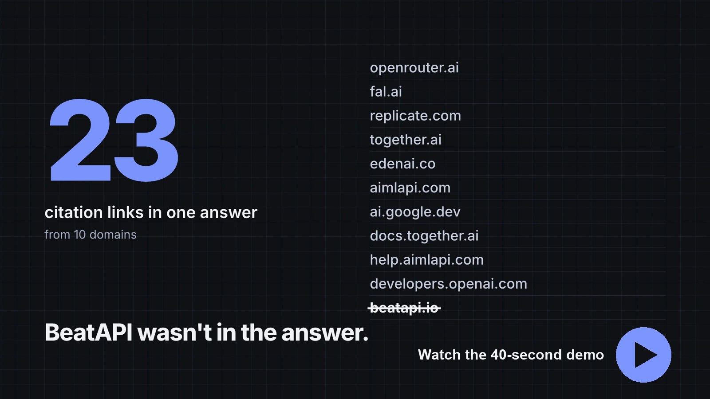
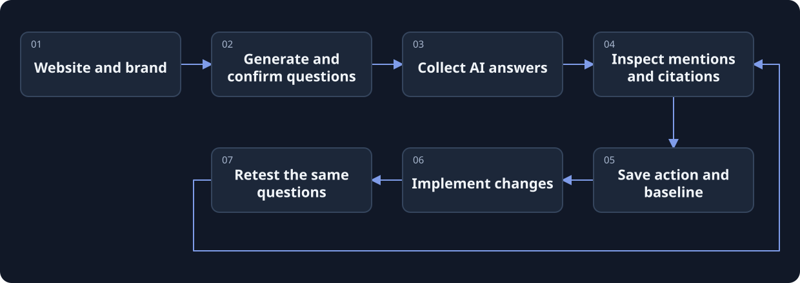
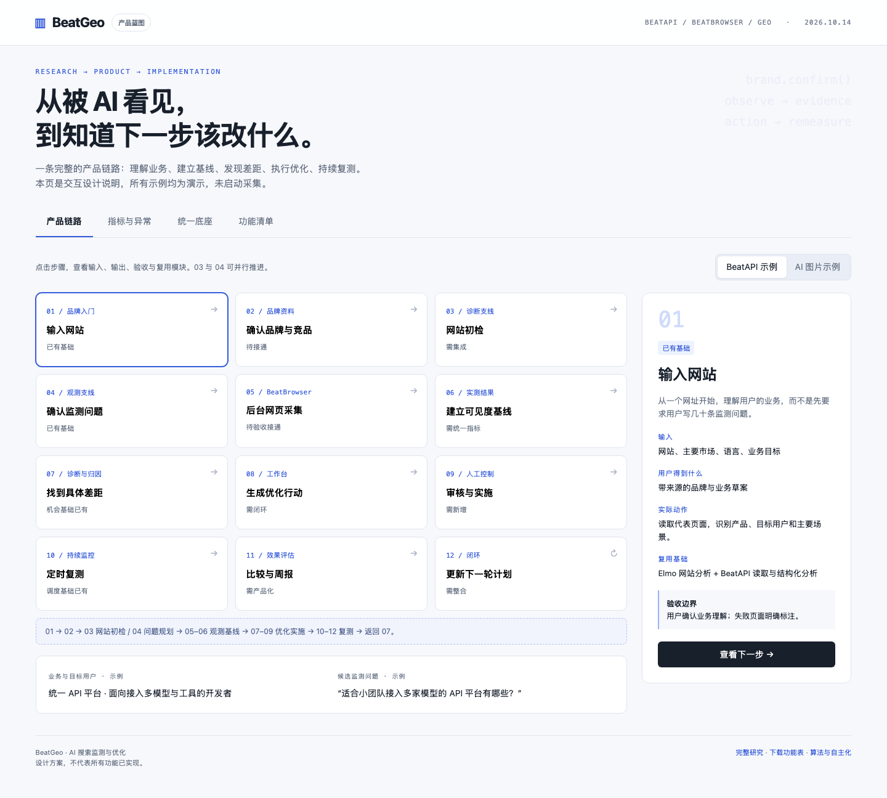

[](https://beatapi.io/geo)

# BeatGEO

English · [简体中文](README.zh-CN.md)

**The open-source Profound alternative for GEO & AEO.**

An open-source GEO / AEO workspace by [BeatAPI](https://beatapi.io). Track brand mentions and citations in real AI answers, turn gaps into actions, and rerun the same questions to compare results.

[Website](https://beatapi.io/geo) · [Quick start](#quick-start) · [Product workflow](#the-product-workflow) · [Current support](#current-support) · [Roadmap](docs/roadmap.md) · [MIT license](LICENSE.md)

[](assets/readme/beatgeo-demo.mp4)

Real screens from a recorded BeatAPI demo run, replayed as a summary rather than a live run. [Case notes](docs/beat-geo/cases/beatapi-agent/README.md)

> **Local MVP / source preview.** The ChatGPT collection → database → worker path has passed live smoke tests. Other engines, paid research and unattended operation have separate acceptance boundaries. [Validation log](docs/beat-geo/validation.md)

## From a website to a repeatable question set

Start with your website and business. Review suggested monitoring questions, collect answers in your signed-in Chrome, and inspect the evidence before deciding what to change.

- **Start with questions, not a blank editor.** Website research generates a draft question set; industry templates work without a research API key.
- **Keep the original evidence.** Inspect answers, visible source links and collection status. A timeout is shown as a timeout, not zero exposure.
- **Make changes measurable.** Save an optimization action and its baseline, record what you implemented, then retest the same questions.
- **Use one local workspace.** Brands, questions, evidence, actions and scheduling share PostgreSQL and one queue. BeatBrowser is included as a pinned dependency.

## Quick start

Prepare **Git, pnpm 12.4.1 and Chrome**. pnpm installs and uses Node.js 24 for this project, whatever Node.js version your system has. PostgreSQL is bundled and managed by BeatGEO; no Docker or separate database installation is required.

```sh
git clone https://github.com/BeatAPI/BeatGEO.git
cd BeatGEO
pnpm start
```

On first start, BeatGEO installs the locked dependencies and generates private local configuration and storage automatically. No `.env` editing or database setup is required. Later starts reuse the same workspace. Partial configuration or existing data never triggers automatic key replacement.

Open **http://localhost:3140/** to enter your local workspace directly. There is no BeatGEO registration, login or password. The **Brand** page at `/brand` brings website, Google, Browser, API Key and monitoring settings together. First-time users add a website there; existing workspaces open SEO directly at `/seo`. GEO questions live at `/questions`. Switch websites in Brand without changing the URL.

1. **Add your website.** Open **Brand** and enter the brand name and domain.
2. **Connect Google (optional).** In **Brand → Website brand**, click **Connect Google**, grant read-only access, select your Search Console site and GA4 property, then open **SEO → Search performance** for search queries or **GEO → AI Traffic & Crawls** for AI referral reports. The desktop client configuration is included; no client ID, client secret or Google Cloud project setup is needed. Google's brand and Analytics permission review is pending, so Google may still show an unverified-app warning and apply access limits.
3. **Connect research (optional).** In **Brand → API Key**, enter your BeatAPI key and choose a research model. You can also start with industry questions without a research key.
4. **Connect Chrome for GEO.** In **Brand → Browser**, follow the extension instructions: load `.beat-geo/extension` via `chrome://extensions` → Developer mode → Load unpacked. Sign in to the AI platforms in that Chrome profile, confirm your questions, then start collection. The extension requests debugger and site access to operate your signed-in browser on your behalf.

The installer prepares a dedicated local PostgreSQL database and the included extension. No second repository clone, BeatBrowser account or global CLI installation is needed. Existing BeatBrowser connections can be reused; enable only one extension copy per profile. If `pnpm local:start` reports a different BeatBrowser version already running, point BeatGEO at that installation with `BEAT_BROWSER_COMMAND` and `BEAT_BROWSER_ARGS_JSON` in `.env`, or update it and its extension together.

**To keep monitoring:** leave the computer awake and online, with Chrome and `pnpm local:start` running. You can close the dashboard tab. Restart with `pnpm local:start`; do not recreate the database. This local edition does not provide monitoring while your computer is offline.

[Detailed onboarding — Chinese](docs/beat-geo/getting-started.md) · [Advanced local PostgreSQL setup](docs/self-hosting.md)

## AI traffic and crawl evidence

Connect Google and select properties in **Brand → Website brand**. Open **SEO → Search performance** for GSC clicks, impressions and queries. Open **GEO → AI Traffic & Crawls** for GA4 AI referrals or to import the site's access log. Visits, crawler declarations and answer citations remain separate. Use **Continue with Google** to authorize Search Console and Analytics together, then choose each property. The desktop OAuth client configuration is bundled; users do not create Google Cloud projects. Real GSC/GA reads have been tested; Google brand and Analytics permission verification is pending. [Setup and evidence limits](docs/ga-and-crawl-sources.md).

## Work from your Agent

Give your MCP-capable Agent a website. The local MCP can create a paused brand, save reviewed questions, queue bounded BeatBrowser collection, inspect evidence, edit shared content drafts and control monitoring. The manual dashboard shows the same project and operation history. [Agent workflow and connection guide](docs/beat-geo/agent-workflow.md).

## The product workflow



BeatGEO owns the product records and schedule. **BeatBrowser** handles the signed-in browser task. **BeatAPI** can supply search, page reading and model analysis for research and optimization.

<details>
<summary>Explore the wider product blueprint</summary>

[](docs/product/flow.html)

Open [the interactive blueprint](docs/product/flow.html) locally to explore its steps. This is the **target product**, including unfinished features and synthetic examples. It is not a screenshot of completed functionality. [Feature inventory](docs/product/features.csv)

</details>

## Current support

| Area | Status |
| --- | --- |
| ChatGPT website collection | Live smoke tests passed through the worker, with answers and visible citations saved. Website changes still require maintenance. |
| Gemini website collection | Adapter present; background completion reliability remains unverified. Failures stay visible. |
| Other answer engines | Full browser collection parity is not claimed. Check the roadmap before relying on an engine. |
| Questions and optimization | English/Chinese question generation, industry templates, saved action baselines and comparable retests. |
| Scheduling and storage | PostgreSQL + pg-boss. The next cycle was queued in live validation; long unattended operation has not been established. SQLite is not supported. |
| BeatAPI research | Search/read/model integration is implemented; acceptance with a real key and billed calls remains pending. |
| Website checks and drafts | Bounded HTML/robots/sitemap checks, free outlines, editable drafts and revision approval. Public-network and paid AI acceptance have stated limits. |
| SEO datasets | Twelve BeatAPI endpoints are available in the SEO analysis workspace, sharing the GEO connection. Keyword search volume is not AI prompt volume. |

**The dashboard opens in English. Switch to Chinese with EN / 中文; your choice is remembered in this browser for later visits.** Questions, brand names and collected answers keep their original language.

## What the numbers mean

**Mention rate = valid answers mentioning the brand ÷ valid, scorable answers.** Failed, pending, timed-out or signed-out attempts do not enter that denominator. Repeated observation IDs are deduplicated.

For example, 24 mentions in 80 valid answers means **30% (24/80)**, even if 100 attempts were planned. Completion coverage is separate. The workbench currently summarizes saved observations, not a complete planned-attempt coverage ledger. A mention is not necessarily a recommendation; this account's sample is not market-wide exposure. [Metric definitions](docs/metrics.md)

## Where BeatAPI fits

Configure the research key and model in **Brand → API Key**. BeatAPI can search for business and competitor information, read pages, generate questions and analyze collected evidence. Saved keys are encrypted and are not returned to the browser client; credentials currently apply to the local instance rather than individual tenants.

Browser collection, starter templates and basic statistics do not require paid model calls. Research and generation use the configured provider's API balance; website collection uses your website account and its limits. SEO analysis uses the same workspace connection; no second key binding is required. [API integration design — Chinese](docs/beat-geo/beatapi-product-loop.md)

## Forking and team use

Forking BeatGEO keeps the **pinned BeatBrowser dependency**; it does not create a separate fork of BeatBrowser. Setup downloads that revision and prepares the extension. Developers changing BeatBrowser itself should fork it separately and explicitly update the dependency and lockfile.

Each local installation has its own private workspace, database, keys and Chrome sessions. Do not commit `.env`, `.beat-geo/`, browser evidence or credentials. Local services bind to loopback; do not expose them through a public tunnel. [Privacy](docs/privacy.md)

## Development and references

```sh
pnpm install --frozen-lockfile
pnpm lint
pnpm test:browser
pnpm test
```

Keep the lockfile and supply-chain protections. Submit changes through PRs. To inspect only the browser lab, run `pnpm browser:lab` and open `http://127.0.0.1:4318`; that standalone view has no product database/account system.

[Architecture — Chinese](docs/beat-geo/architecture-and-ego.md) · [Metrics](docs/metrics.md) · [Roadmap](docs/roadmap.md) · [Validation](docs/beat-geo/validation.md)

## License and acknowledgements

[MIT](LICENSE.md). [BeatBrowser](https://github.com/BeatAPI/BeatBrowser) is included under MIT; see [third-party notices](THIRD_PARTY_NOTICES.md). Other researched GEO projects are references, not a claim that their full implementations are included. BeatGEO is independent of Profound.


## SEO & GEO workspace

After local setup, run `pnpm local:start` (`pnpm seo:workbench` is an alias) and open **SEO → Analysis workspace** in the dashboard. There is no separate SEO service or port to start.

- Save, replace or disconnect your BeatAPI key in **Brand → API Key** (`/brand`). All brands share this encrypted server-side connection for SEO and GEO. A research model is optional for SEO; saving a key makes no remote calls and does not validate balance or access.
- The SEO page starts with the brand website and competitors. Choose the scope, preview the cost, then confirm execution across twelve endpoints.
- Edit and select questions, then **Add to GEO monitoring**. Confirming adds them directly to the current brand’s prompts with SEO source tags. Existing prompts are skipped, including disabled prompts; no existing prompt is overwritten.
- New prompts follow the brand’s current monitoring configuration and schedule, which may incur charges. Adding prompts never calls a model immediately. Paused brands only save prompts; scheduling failures are visible and can be retried without duplicate additions.

The main service protects every SEO asset, mutation and report with local authentication and brand access. SEO reads the shared key without storing a copy; disconnect uses an encrypted empty override so an old environment key cannot silently return. Workers pick up credential changes on their next refresh (about one minute).

Brand reports default to `~/.beat-geo/seo/`; set `BEAT_GEO_SEO_DATA_DIR` for a dedicated storage directory. Import an old standalone snapshot into its matching brand. Synthetic reports cannot add prompts to real monitoring. The legacy standalone CLI/UI remains available through `pnpm seo:standalone` for offline development; it is separate from the unified product connection.

[User guide](tools/seo-geo/references/workbench.md). `pnpm test:seo` and `pnpm test:seo:browser` use synthetic data and mocked HTTP; live provider billing remains unverified.
