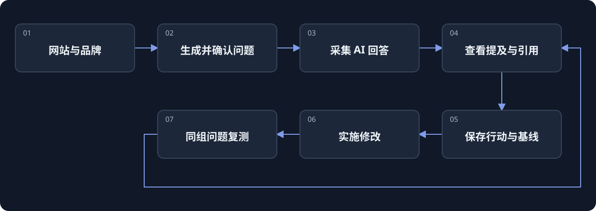

[](https://beatapi.io/geo)

# BeatGEO

[English](README.md) · [简体中文](README.zh-CN.md) · [日本語](README.ja.md) · [Deutsch](README.de.md) · [한국어](README.ko.md)

**面向 GEO 与 AEO 的开源 Profound 替代方案。**

[BeatAPI](https://beatapi.io) 出品的开源 GEO / AEO 工作台。从真实 AI 回答中追踪品牌提及与引用，把发现的问题变成优化行动，再用同一组问题复测效果。

[项目官网](https://beatapi.io/geo) · [快速开始](#快速开始) · [产品闭环](#产品闭环) · [支持范围](#支持范围) · [路线图](docs/roadmap.md) · [MIT 许可](LICENSE.md)

[](assets/readme/beatgeo-demo.mp4)

画面来自 BeatAPI 演示运行（demo run）的录制记录，是结果回顾，不是实时运行。[案例说明](docs/beat-geo/cases/beatapi-agent/README.md)

> **本地 MVP / 源码预览版。** ChatGPT 采集 → 数据库 → worker 已通过真实冒烟测试。其他平台、付费研究与长期无人值守分别验收。[验收记录](docs/beat-geo/validation.md)

## 从一个网站，开始持续观察

填写网站和业务，确认建议题单，再通过已经登录的 Chrome 采集回答。先看原始证据，再决定优化什么。

- **不用从空白题库开始。** 网站研究自动生成初始问题；没有研究 API Key，也能使用行业模板。
- **每个结果都有出处。** 查看原回答、可见引用和采集状态。超时就是超时，不会被当成零曝光。
- **让优化可以复测。** 保存行动和基线，记录实际修改，再用相同问题比较前后变化。
- **一套系统持续维护。** 品牌、问题、证据、行动和调度共用 PostgreSQL 与一个队列；BeatBrowser 已按固定版本集成。

## 快速开始

准备 **Git、pnpm 12.4.1 和 Chrome**。pnpm 会为本项目自动安装并使用 Node.js 24，与电脑上的 Node.js 版本无关。BeatGEO 自带并管理独立 PostgreSQL，无需安装 Docker 或数据库。

```sh
git clone https://github.com/BeatAPI/BeatGEO.git
cd BeatGEO
pnpm local:doctor
pnpm local:setup
pnpm local:start
```

打开 **http://localhost:3140/**，直接进入本地工作台，无需注册、登录或设置密码。可在 `/setup` 连接 BeatAPI 和 Chrome：

1. **连接 Chrome。** 在 `chrome://extensions` 开启开发者模式，加载 `.beat-geo/extension`。选择连接的配置，并在同一配置登录 ChatGPT。扩展连接成功不代表网站已经登录。扩展会申请调试（debugger）和访问所有网站的权限，因为它要在你已登录的 Chrome 中代你操作页面；加载前请先确认这些权限。
2. **创建品牌。** 填网站 → 生成并确认问题 → 首次采集 → 查看回答和引用 → 保存优化行动 → 同组复测。
3. **连接研究能力。** 在 Connections 填入 BeatAPI Key → 验证 → 选择研究模型 → 保存。也可跳过，使用行业模板题库。

安装脚本会准备独立 PostgreSQL 和内置扩展，不必再克隆 BeatBrowser、注册另一套账号或安装全局 CLI。已有 BeatBrowser 可以复用，同一 Chrome 配置只启用一份扩展。如果 `pnpm local:start` 提示本机已在运行其他版本的 BeatBrowser，可在 `.env` 用 `BEAT_BROWSER_COMMAND` 和 `BEAT_BROWSER_ARGS_JSON` 指向那份安装，或把它和扩展一起升级。

**持续监测需要持续运行：** 电脑保持唤醒和联网，Chrome、`pnpm local:start` 保持运行。可以关闭工作台网页；下次执行 `pnpm local:start` 即可，不要重建数据库。本地版不会在电脑离线时继续采集。

[详细使用引导](docs/beat-geo/getting-started.md) · [已有 PostgreSQL 的手动配置](docs/self-hosting.md)

## 产品闭环



BeatGEO 管理产品数据和调度，**BeatBrowser** 执行已登录浏览器任务，**BeatAPI** 为研究与优化提供搜索、网页阅读和模型分析。

<details>
<summary>展开完整产品蓝图</summary>

[](docs/product/flow.html)

下载后打开[交互蓝图](docs/product/flow.html)可查看各步骤。它描述的是**目标产品**，包含未完成功能与合成示例，不是已实现功能的截图。[功能清单](docs/product/features.csv)

</details>

## 支持范围

| 能力 | 当前状态 |
| --- | --- |
| ChatGPT 网页采集 | 真实 worker 链路冒烟测试通过，保存原回答与可见引用；网站变化仍需维护。 |
| Gemini 网页采集 | 已有适配器，后台回答完成的稳定性仍待验证，失败明确显示。 |
| 其他回答引擎 | 尚不承诺完整网页采集支持，请以路线图为准。 |
| 题库与优化 | 中英文问题生成、行业模板、优化行动基线与同组复测。 |
| 调度与存储 | PostgreSQL + pg-boss；实测已排入下一轮任务，长期无人值守仍待验收。不支持 SQLite。 |
| BeatAPI 研究 | 搜索、阅读、模型分析已接入代码，真实 Key 的付费调用仍待验收。 |
| 网站检查与内容草稿 | 有限 HTML/robots/sitemap 检查、免费大纲、可编辑草稿及版本审核；公网检查与真实付费生成的验收边界见报告。 |
| SEO 数据 | 独立本地工作台已支持 12 个 BeatAPI SEO 端点；主仪表盘尚未内嵌。关键词搜索量不代表 AI 提问量。 |

README 提供英文、中文、日文、德文和韩文。**产品界面通过 EN / 中文切换，选择会保存在当前浏览器。** 问题、品牌名和采集原文保留原语言。文档五语言不代表界面五语言。

## 指标怎么计算

**提及率 = 提及品牌的有效回答 ÷ 可评分的有效回答。** 超时、未登录、失败和等待不进入分母，相同 observation ID 去重。

例如计划 100 次，80 次有效，其中 24 次提及，则提及率为 **30%（24/80）**。完成覆盖率应另报；当前工作台汇总已保存观察，完整的计划尝试覆盖账本仍需补齐。提及不等于推荐，当前账号的样本不代表全市场曝光。[指标定义](docs/metrics.md)

## BeatAPI 用在哪里

在 **Connections** 保存研究 Key 和模型。BeatAPI 可以搜索业务与竞品资料、读取网页、生成问题并分析已有证据。Key 加密保存，不回传前端；目前由本地实例统一使用，并非每租户独立凭据。

浏览器采集、行业模板和基础统计不要求付费模型调用。研究与生成消耗配置的提供方 API 余额；网页采集使用你的网站账号及其额度。SEO 专用数据接口可通过下方独立工作台使用；与主仪表盘的连接设置目前分别保存。[API 接入设计](docs/beat-geo/beatapi-product-loop.md)

## Fork 与团队使用

Fork BeatGEO 会保留 **BeatBrowser 的固定版本依赖**，不会额外创建一个 BeatBrowser fork。安装时下载该版本并准备扩展。只有需要改 BeatBrowser 源码的开发者才需要单独 fork，再更新依赖和锁文件。

每台电脑的工作台、数据库、Key 和 Chrome 会话相互独立，不需要 BeatGEO 账号。不要提交 `.env`、`.beat-geo/`、浏览器证据或凭据。本地服务绑定 loopback，不要通过公网隧道暴露。[隐私说明](docs/privacy.md)

## 开发与参考

```sh
pnpm install --frozen-lockfile
pnpm lint
pnpm test:browser
pnpm test
```

保留锁文件及供应链保护，通过 PR 维护。只体验浏览器实验工作台可执行 `pnpm browser:lab`，打开 `http://127.0.0.1:4318`；该独立页面不包含产品数据库与账号系统。

[架构](docs/beat-geo/architecture-and-ego.md) · [指标](docs/metrics.md) · [路线图](docs/roadmap.md) · [验收](docs/beat-geo/validation.md)

## 许可与致谢

[MIT](LICENSE.md)。BeatGEO 基于 Elmo 的 MIT 开源代码，保留原作者版权与历史。[BeatBrowser](https://github.com/BeatAPI/BeatBrowser) 以 MIT 许可集成，详见[第三方声明](THIRD_PARTY_NOTICES.md)。其他研究过的 GEO 项目是参考来源，不代表其全部实现已包含。BeatGEO 与 Profound 无隶属关系。


## SEO & GEO 本地工作台

在仓库根目录运行以下命令，打开 **http://127.0.0.1:4317**：

```sh
node tools/seo-geo/bin/beat-geo-ui.mjs
```

该工具不需要额外依赖或数据库。已经安装主项目依赖的工作区也可使用 `pnpm seo:workbench`。

页面可连接自己的 BeatAPI Key、预览十二个 SEO 端点的查询费用、执行分析、查看历史报告、导入 GEO 回答、整理内容任务并导出问题集。首次可以点击「体验示例报告」，无需 Key 或收费调用。

这是 [`tools/seo-geo`](tools/seo-geo) 下的独立本机单用户工作台，不替换 3000 端口的主仪表盘。保存 Key 不验证权限、不扣费；执行查询需确认范围和预算。开发验证使用模拟 HTTP 与合成数据，未进行真实接口计费验收。

[使用说明](tools/seo-geo/references/workbench.md) · [CLI 与证据规则](tools/seo-geo/README.md)。测试命令：`pnpm test:seo`。
