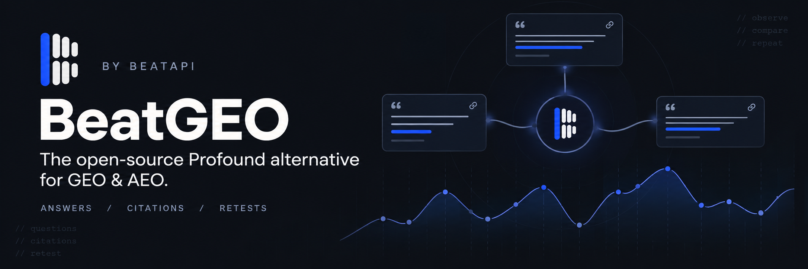
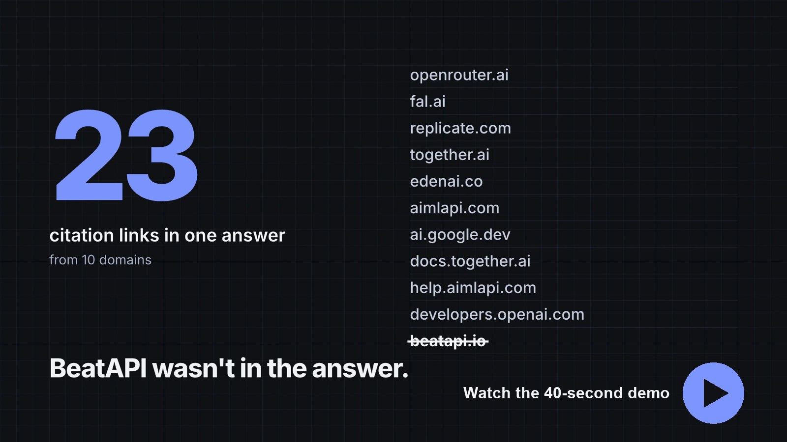
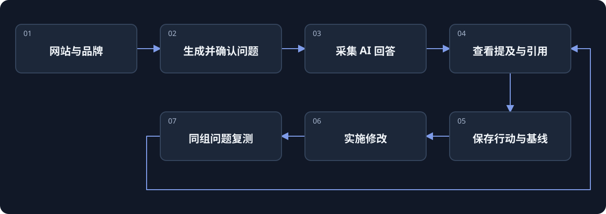
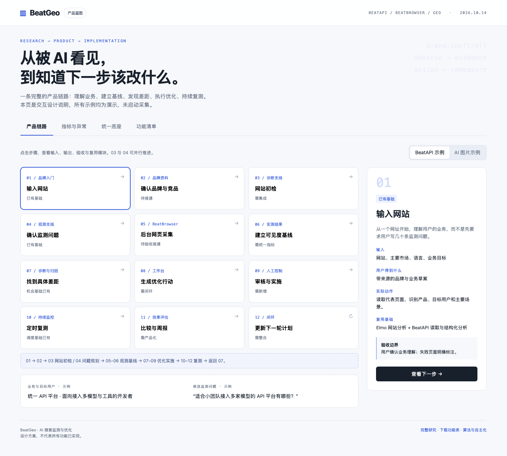

[](https://beatapi.io/geo)

# BeatGEO

[English](README.md) · 简体中文

**面向 GEO 与 AEO 的开源 Profound 替代方案。**

[BeatAPI](https://beatapi.io) 出品的开源 GEO / AEO 工作台。从真实 AI 回答中追踪品牌提及与引用，把发现的问题变成优化行动，再用同一组问题复测效果。

[项目官网](https://beatapi.io/geo) · [快速开始](#快速开始) · [产品闭环](#产品闭环) · [支持范围](#支持范围) · [路线图](docs/roadmap.md) · [MIT 许可](LICENSE.md)

[](assets/readme/beatgeo-demo.mp4)

画面来自 BeatAPI 演示运行（demo run）的录制记录，是结果回顾，不是实时运行。[案例说明](docs/beat-geo/cases/beatapi-agent/README.md)

> **本地 MVP / 源码预览版。** ChatGPT 采集 → 数据库 → worker 已通过真实冒烟测试。其他平台、付费研究与长期无人值守分别验收。[验收记录](docs/beat-geo/validation.md)

## 从一个网站，开始持续观察

填写网站和业务，确认建议题单，再通过已经登录的 Chrome 采集回答。先看原始证据，再决定优化什么。

- **不用从空白题库开始。** 网站研究自动生成初始问题；没有研究 API Key，也能使用行业模板。
- **每个结果都有出处。** 查看原回答、可见引用和采集状态。超时就是超时，不会被当成零曝光。
- **让优化可以复测。** 保存行动和基线，记录实际修改，再用相同问题比较前后变化。
- **一套系统持续维护。** 品牌、问题、证据、行动和调度共用 PostgreSQL 与一个队列；BeatBrowser 已按固定版本集成。

## 快速开始

准备 **Git、pnpm 12.4.1 和 Chrome**。pnpm 会为本项目自动安装并使用 Node.js 24，与电脑上的 Node.js 版本无关。BeatGEO 自带并管理独立 PostgreSQL，无需安装 Docker 或数据库。

```sh
git clone https://github.com/BeatAPI/BeatGEO.git
cd BeatGEO
pnpm local:doctor
pnpm local:setup
pnpm local:start
```

打开 **http://localhost:3140/**，直接进入本地工作台，无需注册、登录或设置密码。首次进入在 **品牌**（`/brand`）添加网站；已添加网站的工作台直接进入 SEO。品牌页统一管理网站、Google、Browser、API Key 和持续监控。

1. **添加网站。** 填入品牌名称和域名。网站切换也在品牌页完成。
2. **连接 Google（可选）。** 在 **品牌 → 网站品牌** 授予只读权限，选择 GSC 站点和 GA4 资源。桌面客户端配置已包含，用户无需创建 Google Cloud 项目或填写客户端 ID、密钥。Google 品牌及 Analytics 权限审核尚未完成，仍可能出现未验证提示或访问限制。
3. **连接研究能力（可选）。** 在 **品牌 → API Key** 保存 BeatAPI Key 和研究模型；也可跳过，使用行业模板题库。
4. **连接 Chrome。** 在 **品牌 → Browser** 按说明开启 `chrome://extensions` 开发者模式，加载 `.beat-geo/extension`，并在同一 Chrome 配置中登录 AI 网站。确认问题后开始采集。扩展通过调试及网站访问权限操作已登录的浏览器。

**SEO → 搜索表现** 展示 GSC 查询词、点击、展现、点击率和排名；**GEO → AI 流量与抓取** 展示 GA 的 AI 来源访问和导入的抓取日志；**答案引擎洞察** 展示 AI 回答中的品牌提及与引用。这三类数据分别展示，不混算。

安装脚本会准备独立 PostgreSQL 和内置扩展，不必再克隆 BeatBrowser、注册另一套账号或安装全局 CLI。已有 BeatBrowser 可以复用，同一 Chrome 配置只启用一份扩展。如果 `pnpm local:start` 提示本机已在运行其他版本的 BeatBrowser，可在 `.env` 用 `BEAT_BROWSER_COMMAND` 和 `BEAT_BROWSER_ARGS_JSON` 指向那份安装，或把它和扩展一起升级。

**持续监测需要持续运行：** 电脑保持唤醒和联网，Chrome、`pnpm local:start` 保持运行。可以关闭工作台网页；下次执行 `pnpm local:start` 即可，不要重建数据库。本地版不会在电脑离线时继续采集。

[详细使用引导](docs/beat-geo/getting-started.md) · [已有 PostgreSQL 的手动配置](docs/self-hosting.md)

## 产品闭环



BeatGEO 管理产品数据和调度，**BeatBrowser** 执行已登录浏览器任务，**BeatAPI** 为研究与优化提供搜索、网页阅读和模型分析。

<details>
<summary>展开完整产品蓝图</summary>

[](docs/product/flow.html)

下载后打开[交互蓝图](docs/product/flow.html)可查看各步骤。它描述的是**目标产品**，包含未完成功能与合成示例，不是已实现功能的截图。[功能清单](docs/product/features.csv)

</details>

## 支持范围

| 能力 | 当前状态 |
| --- | --- |
| ChatGPT 网页采集 | 真实 worker 链路冒烟测试通过，保存原回答与可见引用；网站变化仍需维护。 |
| Gemini 网页采集 | 已有适配器，后台回答完成的稳定性仍待验证，失败明确显示。 |
| 其他回答引擎 | 尚不承诺完整网页采集支持，请以路线图为准。 |
| 题库与优化 | 中英文问题生成、行业模板、优化行动基线与同组复测。 |
| 调度与存储 | PostgreSQL + pg-boss；实测已排入下一轮任务，长期无人值守仍待验收。不支持 SQLite。 |
| BeatAPI 研究 | 搜索、阅读、模型分析已接入代码，真实 Key 的付费调用仍待验收。 |
| 网站检查与内容草稿 | 有限 HTML/robots/sitemap 检查、免费大纲、可编辑草稿及版本审核；公网检查与真实付费生成的验收边界见报告。 |
| SEO 数据 | SEO 分析工作台已支持 12 个 BeatAPI SEO 端点，与 GEO 共用连接设置。关键词搜索量不代表 AI 提问量。 |

**界面默认英文，可通过 EN / 中文切换；切换后会记住你的选择，之后在这个浏览器里默认使用该语言。** 问题、品牌名和采集原文保留原语言。

## 指标怎么计算

**提及率 = 提及品牌的有效回答 ÷ 可评分的有效回答。** 超时、未登录、失败和等待不进入分母，相同 observation ID 去重。

例如计划 100 次，80 次有效，其中 24 次提及，则提及率为 **30%（24/80）**。完成覆盖率应另报；当前工作台汇总已保存观察，完整的计划尝试覆盖账本仍需补齐。提及不等于推荐，当前账号的样本不代表全市场曝光。[指标定义](docs/metrics.md)

## BeatAPI 用在哪里

在 **品牌 → API Key** 保存研究 Key 和模型。BeatAPI 可以搜索业务与竞品资料、读取网页、生成问题并分析已有证据。Key 加密保存，不回传前端；目前由本地实例统一使用，并非每租户独立凭据。

浏览器采集、行业模板和基础统计不要求付费模型调用。研究与生成消耗配置的提供方 API 余额；网页采集使用你的网站账号及其额度。SEO 分析使用同一处连接设置，不需要再次绑定 Key。[API 接入设计](docs/beat-geo/beatapi-product-loop.md)

## Fork 与团队使用

Fork BeatGEO 会保留 **BeatBrowser 的固定版本依赖**，不会额外创建一个 BeatBrowser fork。安装时下载该版本并准备扩展。只有需要改 BeatBrowser 源码的开发者才需要单独 fork，再更新依赖和锁文件。

每台电脑的工作台、数据库、Key 和 Chrome 会话相互独立，不需要 BeatGEO 账号。不要提交 `.env`、`.beat-geo/`、浏览器证据或凭据。本地服务绑定 loopback，不要通过公网隧道暴露。[隐私说明](docs/privacy.md)

## 开发与参考

```sh
pnpm install --frozen-lockfile
pnpm lint
pnpm test:browser
pnpm test
```

保留锁文件及供应链保护，通过 PR 维护。只体验浏览器实验工作台可执行 `pnpm browser:lab`，打开 `http://127.0.0.1:4318`；该独立页面不包含产品数据库与账号系统。

[架构](docs/beat-geo/architecture-and-ego.md) · [指标](docs/metrics.md) · [路线图](docs/roadmap.md) · [验收](docs/beat-geo/validation.md)

## 许可与致谢

[MIT](LICENSE.md)。[BeatBrowser](https://github.com/BeatAPI/BeatBrowser) 以 MIT 许可集成，详见[第三方声明](THIRD_PARTY_NOTICES.md)。其他研究过的 GEO 项目是参考来源，不代表其全部实现已包含。BeatGEO 与 Profound 无隶属关系。


## SEO & GEO 统一工作空间

按上方本地安装步骤完成设置后运行 `pnpm local:start`（`pnpm seo:workbench` 是同一入口）。在主产品打开 **SEO → 分析工作台**，不需要单独启动其他服务或端口。

1. 在**品牌 → API Key**（`/brand`）保存 BeatAPI Key 一次。更换和解除连接也在这里；全部品牌的 SEO 与 GEO 共用它。SEO 不要求配置研究模型，模型可稍后设置。保存不会发起远程查询或验证余额。
2. SEO 自动带入当前品牌的网站和竞品。选择范围、市场和关键词，预览费用后确认执行；12 个端点均可使用。
3. 在**内容与问题**编辑并勾选问题，点击**加入 GEO 监测**。确认当前品牌后，问题直接进入该品牌的问题列表，不用下载再导入。重复问题会跳过，已有停用问题保持停用。
4. 新问题按品牌现有配置与周期安排采集，可能产生费用；加入操作不会立即调用模型。暂停品牌只保存问题。排期失败会明确提示，重试不会重复新增。

SEO 请求在主服务内运行，不需要额外端口；主产品认证和品牌权限保护每份报告。Key 使用主产品加密存储，SEO 页面不保存副本。更换后新 SEO 查询读取新 Key；解除连接阻止环境变量中的旧 Key 恢复，worker 最迟在下一次凭据刷新（约一分钟）同步。

品牌 SEO 报告默认保存在 `~/.beat-geo/seo/`，可用 `BEAT_GEO_SEO_DATA_DIR` 设置专用目录。原独立工作台报告可在对应品牌内导入快照；合成示例不能加入真实监测。旧独立 CLI/工作台仍可用 `pnpm seo:standalone` 运行，用于离线调试，它不属于统一连接入口。

[详细使用说明](tools/seo-geo/references/workbench.md)。`pnpm test:seo` 与 `pnpm test:seo:browser` 使用合成数据和模拟 HTTP，不验证真实提供方账单。
