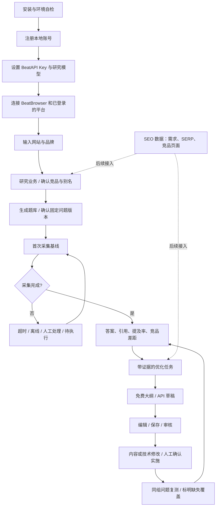

# BeatGEO：实测、Profound 对标与下一轮验收

核对日期：2026-10-16（上海）。基于 `c1e0a5a9`，本轮新增可重复的 MVP 回归入口。这里的“通过”仅覆盖明确列出的测试，不代表全部 Profound 功能已实现。

## 本轮实际跑了什么

| 范围 | 结果 | 证据边界 |
| --- | --- | --- |
| 全新安装 | 通过 | macOS arm64、Node 24.19.0、pnpm 12.4.1；全新临时源码副本执行安装、初始化和迁移；无需 Docker 或手动装数据库 |
| 原生存储 | 通过 | bundled PostgreSQL 17：事务回滚、8 个并发连接、重启持久化、重复实例拒绝；只绑定本机 |
| 单元测试 | 1,478 通过 | config 119、CLI 35、lib 704、deployment 52、web 568 |
| 浏览器 / 安装脚本 | 20 / 17 通过 | 模拟传输和真实安装配置边界，非多平台稳定性证明 |
| PostgreSQL 集成 | 46 通过 | 隔离原生 PostgreSQL，真实迁移与队列；回答是合成数据 |
| 类型检查 / lint / 构建 / 许可证 | 通过 | 12 个类型检查任务、864 个 lint 文件、web 生产构建；1,451 个依赖许可证检查通过 |
| 首次使用 UI | 通过 | 新账号注册、连接页 worker 就绪、图片业务模板 12 题保存；未填写付费 Key |
| 采集失败 UI | 通过 | 空回答显示为失败；没有制造有效观测或零曝光；单题采集可提交到队列 |
| 网站检查 UI | 有限通过 | 检查请求与结果持久化通过；本机 DNS 将测试公网域名解析到保留地址，安全检查拒绝连接，9 项显示未知。HTML 检测与重定向边界通过单元测试，不能宣称公网抓取已通过 |
| 内容与复测 UI | 通过 | 隔离合成基线 → 免费大纲 → 编辑保存 → 审核 → 记录实施 → 复测排队；无发布行为，缺失复测样本不计零 |
| 重启验收 | 通过 | 账号登录、品牌、题库、网站检查、审核后任务保留，worker 恢复就绪；环境中错误的 DATABASE_URL 没有覆盖工作区配置 |
| 中英 / 窄屏 | 通过指定页面 | Connections 与 Opportunities；390px 无水平溢出，非全站逐页验收 |
| 本轮真实 ChatGPT | 通过一次 collector 冒烟 | 已登录 Chrome、独立 BeatBrowser 任务；仅发送一次，296,957ms 完成，11,180 字符、18 个可见引用；未提及 BeatAPI。原始回答留在私有本地证据，不上传账户内容 |
| BeatAPI 真实 Key / 消费 | 未验证 | 研究及草稿调用复用现有加密 Key；没有凭单元测试宣称真实权限、计费或生成质量通过 |
| Gemini / 其他平台、跨天与睡眠恢复 | 未验证 | 不把 ChatGPT 一次成功外推到其他平台或无人值守能力 |
| Windows / Linux 原生包 | 未实机验证 | 包已固定版本；本轮只对 macOS arm64 做安装、运行和重启验收 |

UI 使用隔离的无头 Chromium，真实 ChatGPT 只由 BeatBrowser 操作。测试用网页库使用 stub，空回答被正确保留为失败。网站按钮第一次被测试脚本在 hydration 前点击；等待交互就绪后执行成功。ChatGPT 测试客户端最初设置了 4 分钟等待，因此客户端先超时，collector 仍完成并落盘；产品 provider 的等待上限为 16 分钟。读取完成记录确认最终结果，没有重复提交。

## 团队如何重复测试

准备 Node.js 24、项目指定 pnpm 12.4.1 和已安装依赖：

```bash
pnpm local:doctor
pnpm test:mvp
pnpm -r --if-present check-types
pnpm lint
```

`test:mvp` 新建临时目录、随机凭据和空闲端口的原生 PostgreSQL，运行采集契约、脚本、单元及数据库集成测试，结束后停止数据库并清理其临时目录。迁移只针对该隔离测试库，无需 Docker。这不证明真实付费 API、全部 UI 或长期无人值守运行。

本轮未改动 BeatAPI 主站或其数据库，也未迁移已有 BeatGEO 实例。旧 Docker/手动配置继续沿用原数据；新用户默认走内置存储。原生平台包只允许固定版本的必要链接恢复脚本，依据所有者本轮明确授权。

## 用户应走的闭环



没有 Key 时允许行业模板题库。模板不是对网站的真实研究，也不是用户实际提问量。后续试用优先用 BeatAPI 和一个非 API 行业品牌，避免整套流程只适合我们自己。

## 下一轮真实验收：7 天小样本

第一天用 BeatAPI 建一个项目；用团队自有图片产品再建一个项目。每个项目先固定 10 个中性购买意图问题，另放 2 个品牌认知问题，报告分开显示。先跑 ChatGPT；稳定后再逐个加 Gemini、Perplexity、Claude。没有通过的平台标“实验性”，不把 API 接入数量当成网页平台覆盖。

1. **Key 与费用**：填写 Key、验证、选择模型、保存；执行一次网站研究，核对搜索、页面阅读、模型输出与真实用量。无效 Key、余额不足和限流分别可理解地失败，不重复扣费重试。
2. **业务理解**：网站识别出的产品、受众、竞品可修改；图片业务不会生成 API 中转问题；未知业务先询问或降级。
3. **采集与证据**：每个结果有问题版本、时间、平台、账号环境说明、原回答及来源。人工抽查 10 条：引用链接不是导航链接，品牌出现不是用户问题回显。
4. **失败与恢复**：主动断开扩展、关闭任务页、暂停任务；验证不会重复提交，不把失败当没曝光。重载扩展和彻底重启 Chrome 分别验收，后者可能需要重新关联页面。
5. **指标核算**：用 10 条确定结果手算分母；超时不进入负面样本。品牌词与非品牌词分列，mention、recommendation、citation、搜索排名各自独立。
6. **优化与复测**：保存一项有来源的建议和基线，实际修改一个自有页面，记录实施，再复测同一组问题。修改过的问题、失效样本和改变的采集条件不得伪装成可比提升。
7. **持续运行**：跨 3 个实际调度周期观察执行；故意睡眠/唤醒一次，核查漏跑与恢复策略；七天后看重复任务、遗留窗口、失败率、延迟和成本。模型答案变化本身不算软件失败，也不证明优化因果。

建议发布门槛：团队两名成员在独立环境各完成首次使用；上述状态正确且无跨品牌混数据/密钥外露/重复提交；每个平台有独立验收记录。持续采集成功率与耗时先报告实测分子分母，再设 SLO，不凭一次成功宣布稳定。

## Profound 对标：按模块补，不按菜单数量补

Profound 官方功能页包含 Answer Engine Insights、Prompt Volumes、Agent Analytics、Agents、Shopping；导航还包含 Context Manager、AI Marketer、Projects、Documents 和 Pages。2026-10-09 的更新加入 Moz SEO 数据以及基于看板的 AI 分析。下表是产品补齐建议，非 Profound 私有实现说明。

| 能力 | BeatGEO 当前边界 | 下一步 |
| --- | --- | --- |
| 网站初始化、品牌、问题、竞品 | 已有模型研究路径和行业题库；真实 Key 研究待验收 | 已补 worker 心跳与单题采集；继续验收真实研究结果和业务档案 |
| AI 回答监控 | 有 Browser 采集及数据库闭环；平台稳定性不齐 | ChatGPT 稳定性优先，随后 Gemini / Perplexity / Claude；每家有错误状态与完整来源验收 |
| 可见度、SoV、引用与历史 | 有基础指标；完整 SoV 工作台、统一口径和新鲜度仍需补齐 | 展示有效样本数、失败覆盖、品牌/非品牌问题拆分；避免旧样本前向填充冒充新观察 |
| Pages / 技术站点检查 | 独立技术审计未落地 | 有限范围读取 robots、noindex、canonical、结构化数据、关键正文，给出原始证据和修复任务 |
| 优化与复测 | 已实现基线、实施记录、排队复测与匹配比较 | 已补免费大纲、引用辅助草稿、版本审核和 Markdown 复制；后续再做 CMS 发布回执 |
| Context / AI Marketer / Agents | 没有完整品牌知识库和通用工作流编辑器 | 先做 3 个可用模板：竞品差距、引用机会、周报；共用现有账号、权限、pg-boss 与证据 |
| Prompt Volumes | 没有等价真实需求数据资产 | SEO 量作为搜索需求信号；真实 AI 对话数据需单独授权、覆盖说明和估计方法 |
| Agent Analytics | 没有完整 CDN/GSC/GA4 接入 | 爬虫访问、人类来源访问、转化分别建模；不把 UA 字符串单独当已验证爬虫身份 |
| Shopping | 未接入 | 产品/SKU/商家/价格/商品卡独立模型，后续阶段验收 |
| 企业协作与运维 | 有基础组织权限；不是成熟托管 SaaS | 备份恢复演练、设备在线状态、跨 worker 租约、任务预算、通知交付 |

P0 是首次使用、数据可信度和持续执行；P1 是站点检查、SEO 数据、来源机会与内容草稿；P2 才是通用 Agent 编辑器、复杂集成、Shopping 和企业能力。功能广度可以逐步对标，数据规模与有效性必须单独证明。

## 给 SEO 接入同学的边界

不要为供应商再增加账号、任务库、钱包或独立 UI。上游接入和计费归 BeatAPI 网关；BeatGEO 通过同一 Key 消费客户可见契约，并把结果关联现有品牌、问题、页面和优化任务。

| 首批能力 | 产品用处 | 最低验收 |
| --- | --- | --- |
| 关键词建议与搜索量 | 题库主题发现和优先级 | 国家、语言、时间窗口、估算标识；不能写成 AI 提问量 |
| SERP / AIO | 看引用候选页和竞品出现位置 | 地区、语言、设备、结果类型；没触发 AIO 与请求失败分开 |
| 竞品排名词与 Top Pages | 找内容缺口和承接页 | 域名/页面范围、来源时间、分页/采样覆盖 |
| 引用域/外链 | 寻找第三方来源机会 | 外链与 AI 引用分开；供应商评分不能混成同一个权威分 |

建议契约包含 `schemaVersion`、`capability`、`requestId`、`observedAt`、`sourceType`、`country`、`language`、`device`、`coverage`、`status`、`data`，以及网关确实提供时才记录的 `usage`。状态至少区分成功、部分成功、不可用、限流、失败；没有购买或没有连接时为空/未连接，不返回假 0。字段是待评审建议，不是已上线 API 端点。

流程：先确定客户契约 → 接供应商 → 用固定小样本核对真实返回与计费 → 网关投影 → BeatGEO 适配 → 题库/机会页使用。不要让前端接触供应商 Key、成本或内部错误。站点技术检查可独立于商业 SEO 数据先做，不必等采购完成。

## 本轮开源候选复核

GitHub 仓库元数据于本轮读取；README 功能声明不是部署验收。尚未导入代码或部署候选项目。

| 项目 | 许可证 / 最近推送 | 值得进一步阅读 | 集成方式 |
| --- | --- | --- | --- |
| oneglanse/oneglanse | MIT / 2026-10-04 | 多网页平台回答、引用提取和回答分析 | 只移植适配思想到 BeatBrowser；不再引入它的 Camoufox、账户和任务栈 |
| Albert-Weasker/niubigeo | Apache-2.0 / 2026-10-10 | 域名认知、关键词独立历史和原始证据呈现 | 借鉴研究流程；API 观测继续单独标记，复用代码须保留相应许可/NOTICE |
| Pupok462/open-geo | MIT / 2026-10-07 | 按引擎的操作手册、来源与引用分层 | 可用于人工校验清单，不以自然语言 playbook 代替稳定性测试 |
| qq136692547-cmyk/geo-score | MIT / 2026-10-13 | 技术站点审计与可解释修复项 | 仅作候选；同名项目多，需锁定仓库和代码验证，准备度分不能冒充曝光预测 |

后续由用户主动发起增量研究，不设定时任务。本轮曾创建的研究自动化已按用户要求删除。研究时查 GitHub 与 Profound 官方更新，附许可证、来源、对应模块与验收方法；不自动合入或发布。

## 来源

- [Profound 功能页](https://www.tryprofound.com/features)
- [Profound 更新日志](https://product.tryprofound.com/changelog)
- [Answer Engine Insights 指标介绍](https://help.tryprofound.com/articles/5194011335-interpret-answer-engine-insights-v2)
- [OneGlanse](https://github.com/oneglanse/oneglanse)
- [NiubiGEO](https://github.com/Albert-Weasker/niubigeo)
- [open-geo](https://github.com/Pupok462/open-geo)
- [geo-score 候选仓库](https://github.com/qq136692547-cmyk/geo-score)
- 本项目：`docs/metrics.md`、`docs/beat-geo/validation.md`、`docs/beat-geo/beatapi-product-loop.md` 与本轮测试输出。历史 feature CSV 中的状态早于后续实现，应结合本次实测阅读。


## Dark AEO workspace follow-up

The source edition now defaults to dark mode across authentication, setup, settings, the workspace and report previews. Opportunities separates recommendations, actions/retests, observed answers and website checks. Collection failures are visible above saved actions; no-answer chart cards no longer imply that a job is running. Developer tools are opt-in with `VITE_DEVTOOLS=true`.

Local browser checks used the isolated installation and synthetic acceptance data: login/setup/settings, EN/中文, all four opportunity tabs, retained question selection and expanded draft across tab switches, visible empty-answer failures, dark account menu, and a 390px viewport without horizontal page overflow. No paid generation, new real-engine run, populated recommendation report, exported PNG or print-output acceptance is claimed by this UI pass. Production build, web typecheck, workspace lint and 568 web unit tests passed.


## Typography and layout refinement

The workbench uses locally bundled Geist Sans and Geist Mono, with explicit Chinese system-font fallbacks. Browser inspection on macOS confirmed PingFang SC Medium for the Chinese page heading. The outer inset frame and repeated AEO section cards are removed; compact left-aligned tabs, separators and a collection status rail establish hierarchy. Draft text uses the reading font; only the editor itself is enclosed.

Verified in the isolated synthetic dataset: EN/中文 actions view, all four AEO tabs, selected question and expanded draft retention across tab switches, visible empty-answer status, and 390px responsive layout without page overflow. The question picker and action stack on small screens. No real AI calls or database schema changes were introduced. Populated recommendation reports and report exports still require separate visual acceptance.
