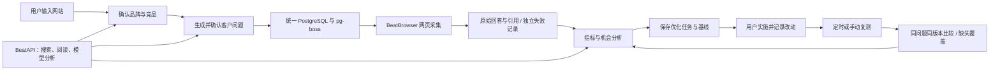

# BeatGEO MVP：产品边界与 BeatAPI 商业闭环

核对日期：2026-10-15。当前版本定位为源码自托管 MVP；托管 SaaS、完整 Profound 功能对齐、全部平台稳定采集均不是本版承诺。

## 一条产品链路

BeatGEO 负责本产品的账号权限、品牌、问题、证据、优化任务和调度。BeatBrowser 负责同机已登录 Chrome 的执行。BeatAPI 网关负责能力调用、API key、余额和计费，BeatGEO 不建设第二套钱包。Browser Lab 是执行器与证据缓存，不是第二个客户数据库或任务调度器。

## 本轮实现的边界

- PostgreSQL 是唯一受支持的业务数据库。SQLite 是后续本地部署选项；不能只改连接串，也不会同步运行两套业务数据库。
- 每次采集先写 `collection_attempts`。同一个队列任务、问题、目标和采样序号只发起一次采集。
- 回答、引用和成功状态在同一事务内提交。空回答和引用写入失败都不能留下看似成功的曝光记录。
- 超时、浏览器忙、离线、页面未就绪、需要人工处理、空回答分别显示。原始上游错误不进入产品状态文案。
- 所有 `process-prompt` 入口使用同一重试和超时策略：不由队列整批自动重放已付费采集；下一周期按已有回退策略安排。
- 同机浏览器模式首版限制为一个 worker、每问题每目标一次采样，串行使用执行器。它不是多设备浏览器集群。
- 页面刚打开时只对 `PAGE_BUSY` 做有界的只读就绪检查；不自动刷新、抢焦点、恢复人工暂停或重复提交问题。
- 优化任务保存当时的基线快照。只有品牌下的问题可以进入基线；每个所选问题都必须已有有效基线。
- 用户填写实施记录后才开启比较，实施时间不能通过重复点击覆盖。
- 手动复测使用同一 pg-boss 队列，明确可能产生 API 费用；同一任务的问题在五分钟内去重。它不是立即获得答案的承诺。
- 对比按问题 ID、问题正文、提供方、模型版本、搜索配置、品牌名称/别名/域名定义匹配。变化的配置或缺失结果不当作零曝光。
- 对比使用每组最新的有效样本，并同时显示匹配数与缺失数。结果是描述性变化，不声称优化行为导致了变化，也不是统计显著性检验。
- 工作台展示最近 50 次尝试及 50 个行动；比较最多读取 2,000 次已完成观察。基线来源限最近 30 天，超出范围会表现为缺失，不填充推测值。
- 网页采集尚不能可靠锁定底层模型版本、地区或搜索开关。`beat-browser` 只是采集器标记，无法证明两个网页样本的底层模型完全相同；这类比较只能视为当前账号条件下的趋势。

## BeatAPI 已接入的代码入口

以下为已实现且通过契约测试的代码路径；本轮未持真实 BeatAPI key 验证付费调用、模型权限或实际费用。

本地实例管理员进入 **Connections (`/setup`)**，填写 BeatAPI key，验证后读取可用模型并选择研究模型。key 和模型使用现有加密凭据机制保存在同一个数据库，worker 每分钟刷新。也兼容服务器端 `BEATAPI_API_KEY` / `BEATAPI_RESEARCH_MODEL`。验证只检查账户及模型列表，不代表实际付费生成已成功。

| 产品位置 | 调用能力 | 实现情况与价值 |
|---|---|---|
| 网站/业务识别、竞争对手建议 | Web Search + 页面阅读 + 文本模型 | 接入现有 onboarding；为提示词提供可阅读的来源，不仅是搜索摘要 |
| 客户问题建议 | 同一个研究提供方 | 根据业务生成候选问题，用户确认；不是观测到的真实提问量 |
| 机会分析 | 文本模型结构化输出 | 对已采集的指标/引用做一次分析，复用现有报告缓存 |
| 可选 API 回答实验 | Chat Completions | 独立 `api-simulation` 标签，不能冒充 ChatGPT 网页结果 |
| 内容草稿、FAQ、比较页、事实校验 | 文本模型 + 阅读/搜索 | 下一阶段；本版没有新增自动发布或完整内容编辑器 |
| 竞品站点地图、深度研究 | Web Map / Research | 官方文档提供能力，本版尚未接入调用路径 |
| 社交平台搜索与帖子数据 | 已有 Social Data 能力 | 后续按 capability inspect 的真实契约接入；本版未实现社媒监控界面 |
| 关键词量、排名词、外链、域名指标 | SEO 数据能力 | 用户确认暂未接入；不构造虚假的现成端点或数据 |

首版的研究请求设有上限：一次搜索、最多读取三页（每页最多 6,000 字符）、一次结构化生成。分析已有证据时不额外搜索。模型输出上限为 8,000 tokens。请求有超时，不因 401/402/429/5xx 静默重复付费调用。搜索结果是线索，读取页面失败时明确失败，不能假装已验证。

API 密钥仅发送至固定 `https://api.beatapi.io`，拒绝重定向，不放在前端构建变量中。当前是自托管实例管理员的统一 key；尚未实现每个 SaaS 租户各自的 BeatAPI key、预算和账单。不要把当前全局凭据配置当成多租户 BYOK。

## SEO 数据资料有什么价值

本轮参考用户本地的《BeatAPI SEO Data API 供应商覆盖与接入清单》（2026-09-28），其中 DataForSEO、哥飞、UnifAPI、GoAnyAPI 是采购与能力评估候选；未把当时价格、文档覆盖或转售许可当作今天已经验证的事实。

| 数据 | 对 BeatGEO 的具体用途 | 必须保留的区别 |
|---|---|---|
| 关键词量、相关词 | 发现问题主题，给内容选题排优先级 | 搜索需求信号不等于 AI 问题量 |
| SERP、排名词、竞品 Top Pages | 发现对手与承接页，补充监控问题 | 搜索排名不等于 AI 提及率 |
| 外链、引用域 | 找可能值得接触的第三方来源 | 外链不等于被 AI 引用，也不保证推荐 |
| 技术 SEO 抓取 | 识别不可访问、内容薄弱、结构缺陷 | 技术合格不等于必然被模型引用 |
| 社交帖子与社区问题 | 发现用户语言、口碑和常见需求 | 发帖数不等于市场需求总量 |
| GSC / GA4 | 获授权后验证搜索点击与站内转化 | 自有站点实测和竞争站估算必须分列 |

每个数据点应携带来源标识、采样时间、国家/语言/设备、观察或估算属性、覆盖范围和失败状态。`null`、真实 0、未采购、采集失败不是一种值。不同公司的权重分不可混成统一 DR；自然搜索流量估算、整站访问量估算与自有站点点击不可相加。

SEO/AEO/GEO 共用的是“发现需求 → 建立事实和内容 → 分发/可访问 → 观察表现 → 改进”的工作流，衡量口径仍然不同。

## 怎么卖

### 第一阶段：开源产品带动真实 API 消费

开源保留品牌/问题管理、浏览器采集、证据、基础指标、行动与复测。让用户先看到自己的数据，再在研究和优化阶段选择 BeatAPI。已有其他提供方继续可用，不通过限制基础能力制造付费需求。

最自然的转化路径：

`首次完成基线 → 看见具体缺口 → 使用 BeatAPI 生成有来源的建议 → 采纳并实施 → 定期复测 → 持续研究与优化`

主入口放在初始化向导、研究提供方设置及分析功能的缺少 key 状态。避免每张图表都插购买按钮。一个管理员 key 配合现有统一能力接口，比要求用户分别注册模型、搜索和数据供应商更省配置工作。

优先计量：首次有效采集率、首次研究成功率、激活 key 数、7/30 日重复使用、采纳的行动数、API 毛利与成功任务成本。GitHub Star 是传播信号，不是收入指标。任务级费用预估/实际费用明细还需要后续开发，本版不承诺已显示完整成本账单。

成本模型应按实际计费单位计算：研究批次 ×（搜索请求 + 成功阅读页数 + 模型 tokens）+ 后续内容/数据请求。网页采集不凭空算成 BeatAPI 消费。不要为了增加调用量，把可本地算的提及率和简单统计交给付费模型。

### 第二阶段：开源核心 + 付费托管服务

可销售的增量是持续在线的调度、团队协作、权限和审计、报告交付、企业集成、数据集与支持。托管浏览器需要合法可用的执行环境与独立的数据访问方案；用户电脑睡眠时，网页监控不会自动变成云端可用。

### 后续闭源产品

可以保留现有 MIT 开源核心，并为我们拥有权利的新模块、托管运维和数据服务采用商业模式。已发布的 MIT 代码不能靠改仓库名称或删历史收回已授予用户的使用权；原作者版权和许可声明仍需保留。接受外部贡献前明确贡献许可与未来商业授权安排，不承诺所有历史贡献都可以任意重新授权。

这是产品路径建议，不是立即变更许可证。本轮保持 MIT。

## 核验来源

- [BeatAPI Web Search 文档](https://docs.beatapi.io/web-search)：Search / Read / Map / Research 契约。文档存在不等于本轮持真实 key 实调成功。
- [BeatGEO 许可证](../../LICENSE.md)、[MIT 原文](https://opensource.org/license/mit)。
- 2026-10-15 公开 capability search 可发现 `data:web.search`；SEO 目录检索未找到对应专用入口，用户进一步确认 SEO 尚未接入。精确模型权限与费用以具体 key 的实际结果为准。
