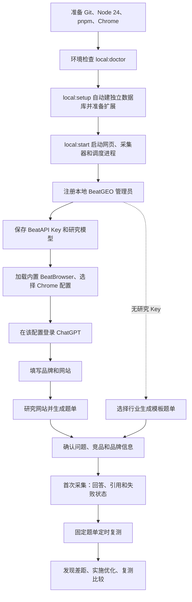
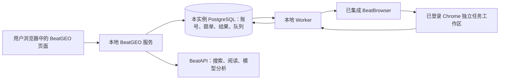

# BeatGEO 从安装到持续监测

这是当前本地源码版的使用路径。完整网站研究推荐连接 BeatAPI；行业模板题库和网页采集可独立使用。尚无桌面一键安装包或托管 SaaS。



## 安装一次

| 要准备的东西 | 用途 | 用户需要操作什么 |
|---|---|---|
| Git、Node.js 24、pnpm 12.4.1 | 下载和运行当前源码版 | 安装这些工具 |
| 内置 PostgreSQL | 自动保存品牌、问题、证据和任务 | 无需单独安装或配置 |
| Chrome | 运行用户已登录的网站 | 安装 Chrome，选择日常使用的配置 |
| BeatAPI Key、余额、可用研究模型 | 网站研究、生成问题、分析机会 | 在 Connections 验证并保存；模板路线可跳过 |
| ChatGPT 网站账号 | 默认网页采集目标 | 在选定 Chrome 配置登录；与 BeatAPI Key 无关 |

默认使用随依赖安装的 PostgreSQL，由 BeatGEO 启停。用户不需要 Docker、数据库命令或数据库密码。可选 `pnpm local:setup --docker`，已有专用 PostgreSQL 也可按[手动指南](../self-hosting.md)配置；已有数据不会自动转换或覆盖。当前不支持 SQLite。

```sh
git clone https://github.com/BeatAPI/BeatGEO.git
cd BeatGEO
node scripts/local-doctor.mjs
pnpm local:setup
pnpm local:start
```

环境检查只读取工具版本。安装脚本会安装锁定依赖、准备本地 PostgreSQL、生成随机凭据、初始化表并准备扩展。已有配置不会被覆盖。默认打开 http://localhost:3140/setup，若端口被占用会自动选择其他端口，以终端输出为准；首次注册的是本地 BeatGEO 管理员，不会注册或绑定一个新的 BeatAPI 账号。

## 页面引导

1. **连接研究能力。** 获取 BeatAPI Key，验证 → 选择支持结构化输出的文本模型 → 保存。验证只确认访问和模型列表，不会产生生成调用，也不能证明模型生成兼容性。Key 加密存入本实例 PostgreSQL，仅回显前四位；后续自动复用。当前为实例管理员共享凭据，不是每个成员各自绑定。
2. **连接 Chrome。** 仓库已经依赖固定版本 BeatBrowser，安装时复制到 `.beat-geo/extension`，无需克隆第二个项目。在 `chrome://extensions` 开启开发者模式，点“加载已解压的扩展程序”，选择设置页提供的目录。已连接的 BeatBrowser 可复用，避免重复安装。Chrome 要求用户确认，网页不能静默完成此步。
3. **选择配置并登录网站。** 在设置页选中 Chrome 配置，并在同一配置登录 ChatGPT。Chrome 连接成功只代表扩展能通信；网站登录是否可用要通过首次采集确认。无需把浏览器 cookies 上传给 BeatAPI。默认只启用 ChatGPT；Gemini 要另外配置采集目标并验收，其他网页引擎不能视为全部接通。
4. **填写品牌和网站。** 网站研究识别品类、受众、用途，结合 12 类意图生成题单。默认以不带品牌名的问题测自然发现，少量品牌题检查认知。用户主要做确认，可删改，不必从空白逐题填写。网站不可读、研究失败或未配置 Key 时，选择行业生成备用模板；会明确标出它不是网站研究或真实搜索量。
5. **开始首次采集。** 确认后题单存入同一数据库，由现有队列交给 BeatBrowser 独立工作区。浏览器任务串行执行，首批不会瞬间完成。查看原回答、引用和状态；超时、未登录、连接失败不记作零曝光。先检查真实证据，再解读汇总指标。
6. **持续使用。** 之后打开同一品牌看变化，记录优化行动，实施后复测同组问题。固定题单不会每轮重新生成；新建品牌、重新研究或机会分析才会产生对应的研究调用。

## 哪些会产生 API 消耗

| 操作 | BeatAPI 消耗 |
|---|---|
| 保存 Key、读取模型列表 | 不发起生成；实际账户计费以 BeatAPI 为准 |
| 选择行业生成模板题单 | 不调用 API |
| 研究网站、搜索与读取资料、模型生成 | 调用配置的研究提供方；BeatAPI 路线使用其余额 |
| 默认 BeatBrowser 网页采集、基础提及统计 | 不调用 BeatAPI 模型；受 AI 网站账号及额度约束 |
| 机会分析、研究报告 | 使用配置的研究模型 |
| 将来主动配置 API 模型作为采集目标 | 按相应提供方计费；与真实网页观测分开 |

## 持续运行的条件

可关闭 BeatGEO 网页，但电脑要保持唤醒、联网，Chrome、`pnpm local:start` 里的调度与采集进程要运行。关闭电脑就没有实时采集，也不能承诺完整补回离线时段。Key 需要持续有效且有可用额度；AI 网站会话失效时需要重新登录。

再次使用运行 `pnpm local:start` 即可，不必重建数据库或重新填写 Key。默认安装将数据保存在 `.beat-geo/postgres`，退出进程会先停止应用再关闭数据库，重启不会删除记录。停止 BeatGEO 后，一起备份 `.beat-geo/postgres`、`.beat-geo/database.json`、`.env` 与 `apps/web/.env`；不要复制运行中的数据库目录。Docker 用户继续使用原数据卷。备份需包含 PostgreSQL 数据及私密配置/加密密钥；只拷贝数据库而丢失加密密钥，无法恢复已保存 Key。不要用删除数据卷作为“重启”方法。



这里没有向 BeatAPI 主站数据库“POST 数据库”的操作：网页请求本地 BeatGEO 服务，由本地服务读写自己的 PostgreSQL。BeatAPI 网关只处理其能力调用和计费。

## 当前还需要完善的产品体验

- 一键桌面安装与自动启动，让非开发者不必管理终端；当前设置页已显示 worker 心跳。
- 首次研究的小额实测与调用费用呈现；当前 Key 验证不能替代真实付费链路验收。
- 各平台独立的登录检测和采集能力状态；当前以首次任务结果为准。
- 长期运行、离线恢复、跨设备调度和备份恢复工具；当前本机常驻模式不能等同托管监控。

以上是后续工作，不是本版已交付能力。
