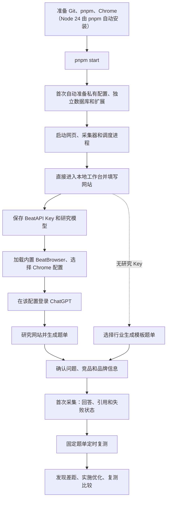
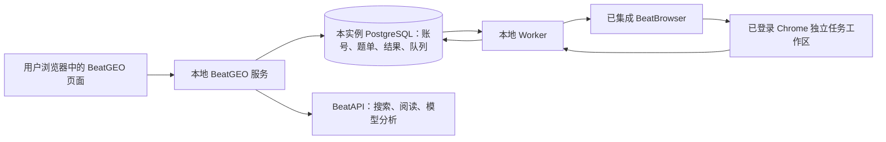

# BeatGEO 从安装到持续监测

这是当前本地源码版的使用路径。完整网站研究推荐连接 BeatAPI；行业模板题库和网页采集可独立使用。尚无桌面一键安装包或托管 SaaS。



## 安装一次

| 要准备的东西 | 用途 | 用户需要操作什么 |
|---|---|---|
| Git、pnpm 12.4.1 | 下载和运行当前源码版 | 安装 Git 和 pnpm；Node.js 24 由 pnpm 自动准备 |
| 内置 PostgreSQL | 自动保存品牌、问题、证据和任务 | 无需单独安装或配置 |
| Chrome | 运行用户已登录的网站 | 安装 Chrome，选择日常使用的配置 |
| BeatAPI Key、余额、可用研究模型 | 网站研究、生成问题、分析机会 | 在品牌 → API Key 验证并保存；模板路线可跳过 |
| ChatGPT 网站账号 | 默认网页采集目标 | 在选定 Chrome 配置登录；与 BeatAPI Key 无关 |

默认使用随依赖安装的 PostgreSQL，由 BeatGEO 启停。运行 `pnpm start` 即可准备并启动本地工作台，无需部署服务器、安装 Docker 或手工设置数据库。只有自行维护本机 PostgreSQL 的开发者才需要[高级手动配置](../self-hosting.md)；已有数据不会自动转换或覆盖。当前不支持 SQLite。

```sh
git clone https://github.com/BeatAPI/BeatGEO.git
cd BeatGEO
pnpm start
```

首次启动自动安装锁定依赖、准备本地 PostgreSQL、生成本机专属凭据、初始化表并准备扩展，无需填写 ENV。再次启动复用已有配置与数据；发现部分配置丢失会停止并提示恢复备份，避免替换加密密钥。默认打开 http://localhost:3140/，首次安装若端口被占用会自动选择其他端口，以终端输出为准。本地工作台自动建立私有身份，无需注册、登录或设置密码；不会注册新的 BeatAPI 账号。

在 **品牌 → 网站品牌** 点击 **使用 Google 继续**，授权后分别选择 GSC 站点和 GA4 媒体资源。桌面公开客户端配置已随代码内置，用户无需创建 Google Cloud 项目、填写客户端 ID 或密钥，也不需要修改 ENV。授权令牌加密保存在本机；用户可以随时断开连接。真实授权与数据读取已跑通；Google 品牌与 Analytics 权限审核仍在进行，批准前可能显示未验证提示或受访问人数限制。

## 页面引导

首次没有网站时进入 **品牌**（`/brand`）添加域名；已有网站时，启动直接打开 **SEO 分析工作台**（`/seo`），不再重复展示网站选择引导。通过品牌页右上角切换或添加网站，当前选择会在本机浏览器中保留。

品牌页左侧有四项，右侧一次显示一个设置区：

1. **网站品牌。** 填写品牌名称和网站。GSC 与 GA 放在这里，点击“使用 Google 继续”授权只读访问，再选择对应资源。别名与其他域名位于折叠的高级设置中。Google 连接可选，不阻挡其他功能。
2. **Browser。** 在 `chrome://extensions` 加载设置页提供的 `.beat-geo/extension`，选择已连接的 Chrome 配置。在同一配置登录 ChatGPT；扩展在线不代表网站已登录，以首次采集结果为准。已有 BeatBrowser 可复用。
3. **API Key。** 保存工作区共用的 BeatAPI Key。检查访问与加载模型是可选操作；网站研究需选择支持结构化输出的研究模型。保存本身不发起 API 调用，密钥在本机加密保存。
4. **持续监控。** 查看数据库、采集服务状态，并进入问题和模型设置。保持电脑唤醒、Chrome 与本地服务运行；配置好题单后才能执行采集。

SEO 和 GEO 保留各自的导航。SEO 提供域名、关键词、外链、报告；GEO 提供问题（`/questions`）、答案引擎洞察、AI 流量与抓取和优化机会。没有研究 Key 时可使用行业模板题单，它不代表网站研究或真实搜索量。首次采集后核对原回答、引用与失败状态；超时或未登录不记作零曝光。后续复测固定题单，新研究与机会分析按实际 API 调用计费。

## 哪些会产生 API 消耗

| 操作 | BeatAPI 消耗 |
|---|---|
| 保存 Key、读取模型列表 | 不发起生成；实际账户计费以 BeatAPI 为准 |
| 选择行业生成模板题单 | 不调用 API |
| 研究网站、搜索与读取资料、模型生成 | 调用配置的研究提供方；BeatAPI 路线使用其余额 |
| 默认 BeatBrowser 网页采集、基础提及统计 | 不调用 BeatAPI 模型；受 AI 网站账号及额度约束 |
| 机会分析、研究报告 | 使用配置的研究模型 |
| 将来主动配置 API 模型作为采集目标 | 按相应提供方计费；与真实网页观测分开 |

## 持续运行的条件

可关闭 BeatGEO 网页，但电脑要保持唤醒、联网，Chrome、`pnpm local:start` 里的调度与采集进程要运行。关闭电脑就没有实时采集，也不能承诺完整补回离线时段。Key 需要持续有效且有可用额度；AI 网站会话失效时需要重新登录。

再次使用运行 `pnpm local:start` 即可，不必重建数据库或重新填写 Key。默认安装将数据保存在 `.beat-geo/postgres`，退出进程会先停止应用再关闭数据库，重启不会删除记录。停止 BeatGEO 后，一起备份 `.beat-geo/postgres`、`.beat-geo/database.json`、`.env` 与 `apps/web/.env`；不要复制运行中的数据库目录。Docker 用户继续使用原数据卷。备份需包含 PostgreSQL 数据及私密配置/加密密钥；只拷贝数据库而丢失加密密钥，无法恢复已保存 Key。不要用删除数据卷作为“重启”方法。



这里没有向 BeatAPI 主站数据库“POST 数据库”的操作：网页请求本地 BeatGEO 服务，由本地服务读写自己的 PostgreSQL。BeatAPI 网关只处理其能力调用和计费。

## 本地访问保护

本地工作台只接受本机 loopback 地址，自动建立私有浏览器会话。跨来源请求、代理地址及直接注册/改密/邀请接口均被拒绝。已有单用户数据库沿用原身份和数据；多用户数据库不会被自动接管。不要通过公网隧道或局域网公开本地服务。

## 当前还需要完善的产品体验

- 一键桌面安装与自动启动，让非开发者不必管理终端；当前设置页已显示 worker 心跳。
- 首次研究的小额实测与调用费用呈现；当前 Key 验证不能替代真实付费链路验收。
- 各平台独立的登录检测和采集能力状态；当前以首次任务结果为准。
- 长期运行、离线恢复、跨设备调度和备份恢复工具；当前本机常驻模式不能等同托管监控。

以上是后续工作，不是本版已交付能力。
